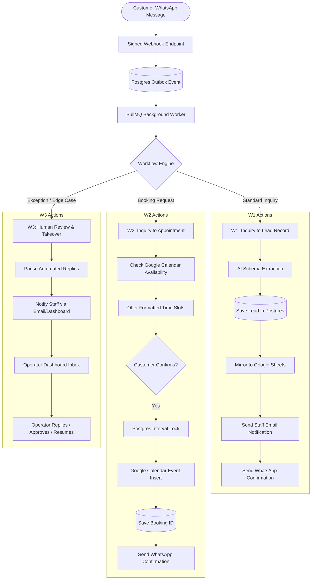

# Virobyte SaaS — Product & Engineering Implementation Plan
**Document Version:** 1.0  
**Target Architecture:** TypeScript Monorepo (Next.js + BullMQ + Supabase/PostgreSQL + Redis + AI Adapter)  
**Based on:** *AI Workflow SaaS Implementation Guide (Blueprint v1.0)*

---

## 1. Executive Summary & Product Vision

**Virobyte SaaS** is an AI-powered business workflow automation platform designed to eliminate missed inquiries, streamline appointment bookings, and automate repetitive administrative tasks for local service businesses.

### Core Value Proposition
- **Initial Target Market:** Small cleaning businesses (single location, single shared booking calendar, repeatable service menu, WhatsApp-first customer communication).
- **Core Promise:** "A business answers guided questions, connects its existing tools (WhatsApp, Google Calendar, Google Sheets), previews and tests an automated workflow, and activates it. The system handles inbound inquiries, collects lead data, locks slots and schedules appointments, mirrors data to spreadsheets, and alerts staff — while seamlessly handing off exceptions to human operators."
- **Foundational Architectural Invariant:** **Bounded Intelligence**. Generative AI is used *strictly* for unstructured interpretation (entity extraction, intent classification, summarization, polite drafting within owner-approved knowledge). Deterministic code governs pricing calculation, calendar reservation, payment handling, and business state transitions. AI is never given autonomous write access or permission to invent policies.

---

## 2. Core Workflows (MVP Scope)



### The Three MVP Workflows:
1. **W1 — Inquiry to Lead Record:**
   - **Trigger:** New inbound customer WhatsApp message.
   - **Action:** AI extracts customer name, requested service, geographic area, and contact details. Validates against business rules.
   - **State Persistence:** Creates/updates tenant-scoped lead in Postgres -> mirrors row to customer's Google Sheet -> dispatches transactional notification email to staff -> replies to customer.
   - **Acceptance:** Replays of duplicate webhook events produce zero duplicate leads and zero duplicate staff emails.
2. **W2 — Inquiry to Confirmed Appointment:**
   - **Trigger:** Inbound booking request or customer confirming a slot.
   - **Action:** Calculates available slots using Google Calendar free/busy API + working hours, service duration, and buffer rules.
   - **Concurrency Control:** Acquires an internal Postgres lock on the time interval -> verifies Google Calendar again -> inserts Google Calendar event -> stores external `event_id` and internal `booking_id` -> confirms to customer and mirrors to Sheets.
   - **Acceptance:** Simultaneous booking attempts by two customers on the same slot cannot result in a double-booking.
3. **W3 — Exception to Human Review:**
   - **Trigger:** Complaints, out-of-area requests, custom pricing queries, ambiguous intent after 2 retries, provider failure, or customer typing "speak to a person".
   - **Action:** Immediately flags conversation as `paused` -> halts queued AI messages -> notifies assigned staff.
   - **Acceptance:** An operator taking over stops all AI background processing; expired action approvals cannot execute stale bookings.

---

## 3. System Architecture & Tech Stack

| Layer | Technology | Key Architectural Decisions |
| :--- | :--- | :--- |
| **Monorepo** | npm / pnpm workspaces | `apps/web` (Next.js Dashboard & Webhooks), `apps/worker` (BullMQ Jobs), `packages/domain` (Business logic), `packages/connectors` (Twilio, Google, Stripe, Resend), `packages/workflows` (State machine), `packages/ai` (Model adapter & prompts) |
| **Frontend** | Next.js (App Router), React, Vanilla CSS | Server components, responsive dashboard, operator inbox, guided setup wizard, zero ad-hoc utility styling. |
| **Database** | PostgreSQL (Supabase) | Multi-tenant schema with Row-Level Security (RLS) on all tables; UUID primary keys; ISO timestamps with timezones (`timestamptz`); monetary amounts in minor integer units (cents). |
| **Auth & Security** | Supabase Auth + AES-256-GCM | RBAC (Owner, Manager, Operator, Platform Support); tenant-scoped JWTs; encrypted credentials storage for OAuth tokens. |
| **Queues & Asynchrony** | BullMQ + Redis | Outbox pattern: Webhook writes event + outbox in 1 Postgres transaction -> Redis dispatcher queues worker job -> Bounded retries with exponential backoff + jitter -> DLQ. |
| **AI Integration** | Server-side Model Adapter | Strict JSON schema validation (`zod`), prompt sandboxing separating system instructions from untrusted customer inputs, regression evaluation suite (100 test cases). |
| **External Providers**| Twilio WhatsApp API, Google Calendar/Sheets API, Resend, Stripe | Provider-neutral connector interfaces; idempotent webhook verification; signed state tokens. |

---

## 4. Definition of Done (DoD) & Engineering Standards

Before any user story or sprint task is marked **DONE**, it must satisfy:
1. **Plain Language Scope:** Intended user outcome, required permissions, and failure modes are explicitly documented.
2. **Multi-Tenant Security:** Verified by automated tests that Tenant A cannot read, mutate, or trigger Tenant B’s data or background jobs.
3. **Idempotency & Resilience:** External write actions use deduplication keys (`action_receipts`). Failed third-party calls enter retry/DLQ with clear operator visibility.
4. **Zero Silent Discard:** Failures notify staff and pause automations with clear recovery instructions; customer inquiries are never silently dropped.
5. **Deterministic Boundaries:** AI outputs pass strict Zod schema parsing; untrusted customer text is treated strictly as data.
6. **Code Quality & CI:** TypeScript strict type checking passes; unit and integration test coverage passes; migrations are additive and rollback-tested.

---

## 5. Agile Sprint Breakdown

All implementation is organized into **2-week iterations (Sprints)** mapped directly to the blueprint delivery phases:

```
[Phase 0: Discovery & Validation]  ---> Sprint 0
[Phase 1: Foundation Architecture] ---> Sprint 1, Sprint 2
[Phase 2: MVP Workflow Delivery]   ---> Sprint 3, Sprint 4, Sprint 5
[Phase 3: Supervised Paid Pilots]  ---> Sprint 6, Sprint 7
[Phase 4: Self-Service & Template] ---> Sprint 8, Sprint 9
[Phase 5: Configurable Platform]   ---> Sprint 10, Sprint 11, Sprint 12
```

---

### Sprint 0: Discovery, Market Validation & Provider Access Checks
**Phase:** Phase 0 | **Timeline:** Weeks 1–2  
**Focus:** Customer validation, provider verification, and business viability checks.

#### Objectives
- Validate actual booking and lead capture bottlenecks with real cleaning business owners.
- Verify provider terms, sandbox feasibility, and account approval prerequisites for WhatsApp, Google Workspace, and Stripe.
- Secure 3 signed paid pilot commitments before writing production software.

#### User Stories & Tasks
- [ ] **US-0.1: Customer Problem Discovery**
  - Compile a list of 30 target cleaning businesses with single locations and shared calendars.
  - Conduct 10 structured 30-minute owner interviews: examine last 5 inquiries, booking bottlenecks, after-hours losses, current tools, and past automation failures.
  - Map the exact happy path and top 5 exception scenarios (e.g., custom requests, out-of-service area, reschedule).
- [ ] **US-0.2: Provider Feasibility & Technical Access Checks**
  - **WhatsApp/Twilio:** Verify ISV / Tech Provider onboarding requirements for WhatsApp Business API; test sandbox messaging (`[S1]`).
  - **Google Cloud:** Set up Google Cloud Console project; test OAuth 2.0 flow for Calendar (`events.insert`, freebusy) and Sheets scopes; document verification requirements (`[S2, S3]`).
  - **Stripe:** Confirm operating entity and bank account eligibility for automated subscription checkout and customer portal (`[S8]`).
- [ ] **US-0.3: Pilot Offer & Validation Gate**
  - Build a high-converting, single-page landing page featuring an interactive or recorded video prototype of the cleaning service inquiry-to-booking workflow.
  - Define pilot package terms: $99–$199/mo + $150 setup fee; usage caps; support hours; cancellation terms.
  - Pitch interviewed prospects to secure **3 paid pilot commitments**.

#### Sprint 0 Exit Gate (Phase 0 Completion)
> [!IMPORTANT]
> **Exit Gate Criteria:** Minimum 3 paid pilot commitments secured; 1 validated repeatable workflow mapped; verified provider path for WhatsApp, Google OAuth, and payments. If gate fails: narrow niche or adjust value proposition before writing code.

---

### Sprint 1: Monorepo Foundation, Multi-Tenant Auth & Core Data Model
**Phase:** Phase 1 (Iteration 1) | **Timeline:** Weeks 3–4  
**Focus:** Project structure, secure database schema, Supabase RLS, authentication, and team roles.

#### Objectives
- Initialize the monorepo workspace and CI/CD pipelines.
- Establish PostgreSQL database schema with strict multi-tenant Row-Level Security (RLS).
- Implement user authentication, organization management, and RBAC.

#### User Stories & Tasks
- [ ] **US-1.1: Monorepo & Tooling Setup**
  - Set up TypeScript monorepo with `apps/web`, `apps/worker`, `packages/domain`, `packages/connectors`, `packages/workflows`, and `packages/ai`.
  - Configure ESLint, Prettier, TypeScript strict mode, and GitHub Actions CI (lint, typecheck, test).
  - Create environment-variable manifest (`.env.example`) documenting every secret and config key.
- [ ] **US-1.2: Multi-Tenant Data Schema & Migrations**
  - Create initial SQL migrations for core identity tables:
    - `organizations` (`id`, `name`, `timezone`, `currency`, `status`, `created_at`)
    - `memberships` (`org_id`, `user_id`, `role` [owner, manager, operator])
    - `business_configs` (`id`, `org_id`, `version`, `config_json`, `created_by`, `created_at`)
    - `services` (`id`, `org_id`, `config_version`, `duration_minutes`, `buffer_minutes`, `price_minor`, `active`)
  - Implement and test PostgreSQL Row-Level Security (RLS) policies on all tables ensuring `org_id` isolation.
  - Write automated cross-tenant test suite verifying that Tenant A cannot query or mutate Tenant B records.
- [ ] **US-1.3: Authentication & Workspace Dashboard Shell**
  - Implement Supabase Auth (Sign-up, Sign-in, Password Reset, Email Verification, Session Management).
  - Build base dashboard navigation (Overview, Conversations, Bookings, Integrations, Settings).
  - Implement role-based navigation guards: operators cannot view billing or modify integrations.
  - Create synthetic business seed script for local development and testing.

#### Sprint 1 Exit Gate
> [!IMPORTANT]
> **Exit Gate Criteria:** Automated CI passes; 2 test organizations can operate simultaneously in isolated environments; cross-tenant data access attempts return 0 rows; RBAC restrictions strictly enforced.

---

### Sprint 2: Guided Onboarding Questionnaire & Connector Simulation
**Phase:** Phase 1 (Iteration 2) | **Timeline:** Weeks 5–6  
**Focus:** Business configuration wizard, connector interfaces, and staging test harness.

#### Objectives
- Build a frictionless, guided onboarding questionnaire for business owners.
- Define connector abstraction contracts (`packages/connectors`) and encrypted credential storage.
- Create mock/sandbox connector adapters allowing full end-to-end dry-run simulation.

#### User Stories & Tasks
- [ ] **US-2.1: Guided Business Configuration Wizard**
  - Build multi-step onboarding wizard in `apps/web`:
    - Step 1: Business Identity (Name, contact, timezone, currency, language).
    - Step 2: Service Catalog (Services, fixed pricing in minor units, durations, cleanup buffers, service areas).
    - Step 3: Operating Hours & Booking Rules (Weekly schedule, holidays, minimum booking notice, max horizon).
    - Step 4: Knowledge & Policy (FAQs, cancellation rules, tone, escalation triggers).
  - Implement save/resume functionality: draft configurations versioned in Postgres with full Zod schema validation.
  - Build dynamic read-only workflow preview highlighting configured rules and action destinations.
- [ ] **US-2.2: Connector Layer & Credential Vault**
  - Implement `connections` and `connector_bindings` tables with AES-256 encrypted token storage.
  - Implement standardized connector TypeScript interfaces:
    - `WhatsAppConnector`: `verifyWebhook`, `normalizeInbound`, `sendText`, `sendTemplate`.
    - `CalendarConnector`: `checkFreeBusy`, `insertEvent`, `cancelEvent`.
    - `SheetsConnector`: `upsertLeadRow`, `syncHeaders`.
    - `EmailConnector`: `sendStaffNotification`.
- [ ] **US-2.3: Staging Simulator & Fake Adapters**
  - Implement Mock/Simulator adapters for WhatsApp, Google Calendar, Sheets, and Email that log intended actions to an in-memory/DB ledger.
  - Provide a "Test Sandbox" in the dashboard where an owner can type simulated WhatsApp messages and observe the compiled workflow's intended outputs without external writes.

#### Sprint 2 Exit Gate (Phase 1 Completion)
> [!IMPORTANT]
> **Exit Gate Criteria:** Non-technical user completes questionnaire without assistance; config compiles into validated JSON; simulator executes full simulated run with zero external writes; staging Google/WhatsApp test connections succeed.

---

### Sprint 3: Transactional Ingestion & W1 (Inquiry to Lead Record)
**Phase:** Phase 2 (Iteration 3) | **Timeline:** Weeks 7–8  
**Focus:** Resilient webhook ingestion, transactional outbox, structured AI extraction, and Google Sheets/Email mirroring.

#### Objectives
- Build reliable, idempotent webhook ingestion with transactional outbox and BullMQ worker.
- Implement server-side AI model adapter with strict Zod validation.
- Deliver production-ready **W1 Workflow** (Inbound WhatsApp message -> Validated Lead -> Sheets -> Email).

#### User Stories & Tasks
- [ ] **US-3.1: Resilient Webhook Ingestion & Outbox Engine**
  - Create `POST /webhooks/whatsapp` endpoint with cryptographic signature validation.
  - Implement atomic write: save raw event in `webhook_events` and queued job in `outbox` in a single Postgres transaction before returning HTTP 200 within 2 seconds.
  - Build `apps/worker` outbox poller/dispatcher dispatching jobs to BullMQ on Redis.
  - Implement message deduplication using provider message ID (`action_receipts`).
- [ ] **US-3.2: Structured AI Extraction & Business Validation**
  - Implement `packages/ai` model adapter supporting OpenAI / Anthropic with JSON schema enforcement.
  - Design extraction prompt separating system rules, approved business config, and untrusted customer text.
  - Extract structured output: `{ intent, customer_name, requested_service, area, preferred_time, missing_fields, needs_human }`.
  - Validate extracted service and area against owner's business rules. If invalid or unsupported, route to W3.
- [ ] **US-3.3: W1 Execution & Multi-Destination Mirroring**
  - Create or update tenant-scoped record in `contacts` and `leads`.
  - Implement `GoogleSheetsConnector.upsertLeadRow`: locate or append row by lead ID; handle quota errors with backoff (`[S5]`).
  - Implement `EmailConnector.sendStaffNotification`: format transactional email via Resend/SendGrid.
  - Send friendly receipt confirmation back to customer via WhatsApp within the 24-hour service window (`[S1]`).

#### Sprint 3 Exit Gate
> [!IMPORTANT]
> **Exit Gate Criteria:** Inbound webhook replayed 10 times results in exactly 1 saved lead and 1 staff email; temporary Google Sheets failure retries automatically without losing DB lead; WhatsApp 24-hour policy strictly enforced.

---

### Sprint 4: W2 (Appointment Booking) & W3 (Operator Inbox / Takeover)
**Phase:** Phase 2 (Iteration 4) | **Timeline:** Weeks 9–10  
**Focus:** Concurrency-safe calendar scheduling, human takeover inbox, and bot pause/resume controls.

#### Objectives
- Deliver **W2 Workflow**: Availability search, slot negotiation, internal locking, and Google Calendar event creation.
- Deliver **W3 Workflow**: Exception escalation, real-time Operator Inbox, takeover mechanism, and approval queues.
- Prevent double-bookings and race conditions during simultaneous customer requests.

#### User Stories & Tasks
- [ ] **US-4.1: Slot Calculation & Availability Engine**
  - Connect Google Calendar Free/Busy API (`[S4]`).
  - Calculate available slots based on business working hours, requested service duration, and buffer intervals.
  - Format slot recommendations in WhatsApp message (e.g., offering 2–3 convenient options in business timezone).
- [ ] **US-4.2: Concurrency-Safe Booking Execution (W2)**
  - When customer confirms a slot, acquire a short-lived pessimistic row lock in `bookings` for that resource and time window.
  - Re-verify Google Calendar availability; insert calendar event via Google Calendar API; commit booking record.
  - Save `external_event_id` and internal `booking_id`; send confirmation WhatsApp message and mirror to Sheets.
  - If slot was taken concurrently, release lock and propose alternative available slots.
- [ ] **US-4.3: Real-Time Operator Inbox & Takeover (W3)**
  - Build Operator Inbox in `apps/web` displaying conversations, extracted details, and current workflow state.
  - Implement automated pause triggers: customer complaint, price dispute, 2 failed clarification attempts, customer requesting a human, or connector error.
  - Provide operator controls: **Manual Reply**, **Take Over**, **Pause Automation**, **Approve Pending Action**, **Resume Automation**.
  - Enforce concurrency safety: operator takeover revokes bot conversation lease (fencing token); queued AI replies are instantly cancelled.

#### Sprint 4 Exit Gate
> [!IMPORTANT]
> **Exit Gate Criteria:** Simulated concurrent booking test proves two customers cannot book the same slot; operator manual takeover immediately stops pending AI background jobs; expired action approvals cannot execute stale bookings.

---

### Sprint 5: Reliability Hardening, Billing & Release Acceptance
**Phase:** Phase 2 (Iteration 5) | **Timeline:** Weeks 11–12  
**Focus:** Failure recovery, Stripe subscription billing, 100-case AI test suite, and production readiness.

#### Objectives
- Implement action receipts, dead-letter queues, circuit breakers, and usage metering.
- Integrate Stripe billing checkout, customer portal, webhook verification, and entitlement enforcement.
- Run comprehensive 100-case AI evaluation suite and staging disaster recovery drill.

#### User Stories & Tasks
- [ ] **US-5.1: Action Receipts, Circuit Breakers & DLQ**
  - Implement `action_receipts` table tracking every external action with `operation_key`, `provider`, `status`, and `payload_hash`.
  - Configure BullMQ retry policies: exponential backoff with jitter (5 attempts max over 15 minutes).
  - Implement Dead-Letter Queue (DLQ) dashboard view for operators to review and retry failed jobs.
  - Add circuit breakers for external provider outages (Twilio / Google / OpenAI) with automatic degraded-status banners.
- [ ] **US-5.2: Stripe Billing & Entitlement Management**
  - Integrate Stripe hosted checkout and customer billing portal (`[S8]`).
  - Implement webhook handler `POST /webhooks/billing` with signature verification.
  - Track subscriptions (`active`, `past_due`, `canceled`) and enforce usage limits (messages/month, active workflows).
  - Grace period handling: on failed payment, notify owner and maintain read-only access without silently dropping incoming leads.
- [ ] **US-5.3: Security Audits & AI Evaluation Harness**
  - Run automated 100-case evaluation suite in `packages/ai`: test typical inquiries, typos, ambiguous dates, prompt injections, and complaints. Minimum pass target: **95% field extraction accuracy**, **0 unauthorized actions**.
  - Penetration testing: test cross-tenant IDOR across all API endpoints, file storage signed URLs, and webhook payloads.
  - Execute database backup restore drill on staging; verify recovery time objective (< 4 hours) and point-in-time recovery.

#### Sprint 5 Exit Gate (Phase 2 Completion)
> [!IMPORTANT]
> **Exit Gate Criteria:** 100-case AI suite passes with >=95% accuracy and zero security violations; Stripe checkout and webhooks fully functional; zero known critical security defects; operator runbooks documented.

---

### Sprint 6: Supervised Paid Pilot Deployment
**Phase:** Phase 3 (Iteration 6) | **Timeline:** Weeks 13–14  
**Focus:** Onboarding 1st customer, supervised operation, error triage, and owner training.

#### Objectives
- Onboard Customer #1 in production with supervised mode (manual staff approval required for all outward WhatsApp messages).
- Review all execution logs daily to eliminate prompt errors or rule gaps.
- Deliver owner training video (5 min) and staff 1-page operational guide.

#### User Stories & Tasks
- [ ] **US-6.1: Production Deployment & Verification**
  - Deploy `apps/web` and `apps/worker` to production environment (aligned regions for Postgres, Redis, and compute).
  - Execute end-to-end smoke test on production with dedicated test phone number.
  - Verify SPF, DKIM, and DMARC DNS records for transactional email delivery.
- [ ] **US-6.2: Customer #1 Supervised Onboarding**
  - Onboard Pilot Business #1: configure services, pricing, calendar, and sheet destinations.
  - Set workflow to **Supervised Mode**: all outward WhatsApp messages and calendar bookings queue in Operator Inbox for one-click staff approval.
  - Deliver 5-minute owner onboarding video and 1-page staff quick reference cheat sheet.
- [ ] **US-6.3: Daily Triage & Rapid Hardening**
  - Conduct daily review of all conversation logs and workflow runs with business owner.
  - Categorize and fix issues: prompt ambiguity, missing service area validation, customer wording edge cases.
  - Once accuracy reaches 100% over 3 consecutive days, transition from Supervised Mode to Autonomous Mode.

#### Sprint 6 Exit Gate
> [!IMPORTANT]
> **Exit Gate Criteria:** Customer #1 successfully handles 25+ real customer inquiries; zero duplicate bookings; owner expresses satisfaction with automated lead capture; no unresolved blocking bugs.

---

### Sprint 7: Pilot Expansion, Business Metrics & Renewal Gate
**Phase:** Phase 3 (Iteration 7) | **Timeline:** Weeks 15–16  
**Focus:** Multi-customer pilot validation, measured outcome reporting, and paid renewals.

#### Objectives
- Expand live pilot to 3–5 cleaning businesses.
- Measure business ROI: response time reduction, hours of staff time saved, booking conversion rate.
- Achieve the **Paid Pilot Exit Gate** (contract renewals and positive unit economics).

#### User Stories & Tasks
- [ ] **US-7.1: Multi-Tenant Pilot Expansion**
  - Onboard 2 additional committed pilot businesses onto production.
  - Monitor system performance, queue latency, and database connection pools under multi-tenant production traffic.
- [ ] **US-7.2: Business Metrics & ROI Reporting**
  - Implement automated weekly owner outcome digest:
    - Total inquiries captured.
    - Appointments confirmed without staff intervention.
    - Estimated staff hours saved (handling minutes before vs. after).
    - Exception count and response times.
- [ ] **US-7.3: Pilot Review & Commercial Renewal**
  - Conduct formal pilot review meeting with all 3 business owners.
  - Secure written renewals / ongoing subscription commitments at standard commercial pricing ($99–$199/month).
  - Document 1 permission-based customer case study with verified metrics.

#### Sprint 7 Exit Gate (Phase 3 Completion)
> [!IMPORTANT]
> **Exit Gate Criteria:** Minimum 3 paying pilot businesses; at least 2 commit to renew after pilot; technical success rate >= 95% across >= 100 eligible runs; zero duplicate bookings; contribution margin >= 70%.

---

### Sprint 8: Self-Service Setup & Friction Reduction
**Phase:** Phase 4 (Iteration 8) | **Timeline:** Weeks 17–18  
**Focus:** Eliminating manual founder onboarding, self-serve connection UX, and drop-off analytics.

#### Objectives
- Enable new business owners to complete setup and activate workflows with minimal human assistance.
- Add setup diagnostic checklists, connection health testing, and drop-off tracking.

#### User Stories & Tasks
- [ ] **US-8.1: Self-Service Onboarding UX**
  - Implement interactive onboarding checklist with status indicators:
    - [x] Business Profile & Working Hours
    - [x] Connect WhatsApp Number (via official provider embedded signup)
    - [x] Connect Google Calendar & Select Booking Resource
    - [x] Connect Google Sheets & Select Lead Sheet
    - [ ] Run End-to-End Test Simulation
    - [ ] Activate Subscription
  - Provide one-click test inquiry generator with pre-filled test scenarios.
- [ ] **US-8.2: Setup Diagnostics & Stall Telemetry**
  - Implement telemetry events: `setup_started`, `oauth_connected`, `test_passed`, `activated`.
  - Build automated diagnostics: detect disconnected accounts, expired OAuth tokens, or misconfigured sheet column headers with inline one-click repair flows.

---

### Sprint 9: 2nd Workflow Template & Rescheduling Engine
**Phase:** Phase 4 (Iteration 9) | **Timeline:** Weeks 19–20  
**Focus:** Quotation review/recurring cleaning template, appointment reschedule/cancel flows.

#### Objectives
- Expand workflow template catalog with a 2nd validated workflow (Quote Request / Recurring Service).
- Implement customer self-service appointment rescheduling and cancellation via WhatsApp.

#### User Stories & Tasks
- [ ] **US-9.1: 2nd Workflow Template (Quotation / Recurring Cleaning)**
  - Build Template #2: Multi-room custom quotation workflow.
  - Implement intake questions for room counts, deep-clean add-ons, and photo upload review.
  - Compile template dynamically onto the shared workflow engine without bespoke branching code.
- [ ] **US-9.2: Appointment Reschedule & Cancellation Flow**
  - Support customer requests: "I need to reschedule my Friday appointment."
  - Authenticate customer identity via phone number + confirmation of existing booking ID/details.
  - Release previous calendar slot, calculate new availability, update Google Calendar event, and log update receipt.

#### Sprint 9 Exit Gate (Phase 4 Completion)
> [!IMPORTANT]
> **Exit Gate Criteria:** 10+ paying businesses; >= 80% complete setup self-service; 2nd template live in production without code forks; stable 70%+ contribution margin.

---

### Sprints 10–12: Configurable Workflow Platform & AI Assistant
**Phase:** Phase 5 | **Timeline:** Weeks 21–26  
**Focus:** Visual step-list editor, CRM connectors (HubSpot/Pipedrive), and AI-assisted workflow authoring.

#### Objectives
- Deliver a bounded step-list workflow builder (triggers, conditions, field extraction, notifications).
- Add CRM connectors and inbound email webhooks.
- Implement AI workflow drafter that converts a plain-language business description into a validated workflow graph.

#### Key Deliverables (Sprints 10–12)
- **Bounded Step-List Editor:** Drag-and-drop / reorderable action cards with explicit type mapping and pre-publish static graph validation.
- **New Connectors:** Inbound email parser, HubSpot / Pipedrive CRM lead sync, and secured outbound webhooks.
- **AI-Assisted Configuration:** Owner describes their process in natural language ("When someone asks about sofa cleaning, ask for photos and send to Sarah"); AI compiles graph using strictly registered action nodes with human confirmation.

---

## 6. Risk Register & Mitigation Playbooks

| Risk | Likelihood | Impact | Mitigation Strategy | Owner |
| :--- | :--- | :--- | :--- | :--- |
| **WhatsApp / Provider Approval Delays** | High | High | Initiate provider verification in Sprint 0; utilize sandbox simulator for pilot training while production approvals pend. | Founder / Tech Lead |
| **Double Bookings & Race Conditions** | Medium | Critical | Concurrency locks in Postgres (`SELECT FOR UPDATE`), pre-insert recheck against Google Calendar, and atomic booking transactions. | Tech Lead |
| **AI Hallucinations / Prompt Injections** | Medium | High | Strict JSON schema extraction; untrusted customer messages treated as data; hardcoded deterministic business logic for prices/dates. | AI Engineer |
| **Cross-Tenant Data Leakage** | Low | Critical | PostgreSQL Row-Level Security (RLS) on all queries; automated regression tests attempting cross-tenant access; isolated storage buckets. | Tech Lead |
| **Provider API Outages (Google/Twilio)** | Medium | Medium | Transactional Outbox pattern; BullMQ retries with jitter; circuit breakers; degraded-mode operator banners. | Tech Lead |
| **High Customer Churn Post-Pilot** | Medium | High | Weekly ROI digests proving time saved and leads captured; rapid turnaround on owner-reported edge cases. | Founder |

---

## 7. Architectural Decision Log (ADR)

- **D01 — Initial Customer Niche:** Single-location cleaning services selected for repeatable booking patterns and high reliance on WhatsApp.
- **D02 — Monorepo Architecture:** Single TypeScript monorepo with modular packages chosen to avoid premature microservice complexity while enforcing domain boundaries.
- **D03 — Bounded AI Runtime:** Generative AI is strictly an interpreter and drafter; zero autonomous tool orchestration or arbitrary code execution in production workflows.
- **D04 — Database & Multi-Tenancy:** PostgreSQL with Supabase RLS chosen for unified relational integrity, row-level access control, and built-in auth.
- **D05 — Asynchronous Task Processing:** BullMQ + Redis using the Transactional Outbox pattern chosen to guarantee zero lost webhooks and idempotent job execution.
- **D06 — Source of Truth Invariant:** Internal PostgreSQL database is the absolute source of truth for leads and bookings. Google Sheets and Google Calendar are external mirrors.
- **D07 — Billing Model:** Flat monthly SaaS subscription with usage caps + transparent provider pass-through pricing to maintain a strict >70% gross contribution margin.

---

## 8. Immediate Next Steps (Sprint 0 Kickoff Checklist)

1. [ ] **Prospect Outreach:** Contact 15 local cleaning businesses to schedule the first 5 discovery interviews.
2. [ ] **Twilio / WhatsApp Verification:** Register developer account and verify ISV Tech Provider onboarding path.
3. [ ] **Google Cloud Project:** Create staging GCP project, enable Calendar and Sheets APIs, and test OAuth 2.0 consent screens.
4. [ ] **Stripe Account:** Verify operating country eligibility and setup developer sandbox.
5. [ ] **Monorepo Repository Init:** Initialize Git repository and establish CI workflows.
