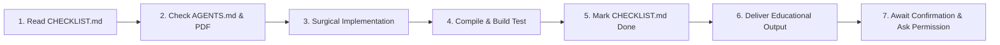

# AGENTS.md — Developer & AI Operating Standard for Virobyte SaaS

Welcome to **Virobyte SaaS**. This document is the authoritative rulebook and operating standard for AI coding agents and human developers collaborating on this codebase. It establishes our development methodology, architectural invariants, code quality standards, and mandatory communication protocols.

---

## 1. System Mission & The Three Sources of Truth

**Virobyte SaaS** is an AI-powered workflow automation platform designed for local service businesses (initial niche: **single-location cleaning companies**). It eliminates missed inquiries, automates scheduling without double-booking, syncs records to spreadsheets and calendars, and routes exceptions to staff.

### The Canonical Three Sources of Truth
The entire project is governed by exactly **three non-overlapping documents**:

| Document | Authority Level | Primary Role |
| :--- | :--- | :--- |
| **1. Master Blueprint:** [`AI_Workflow_SaaS_Implementation_Guide.pdf`](file:///c:/Users/Admin/OneDrive/Desktop/virobyte-saas/docs/AI_Workflow_SaaS_Implementation_Guide.pdf) | **Immutable Truth** | The 33-page, 31-section product and engineering specification. All architectural choices, database structures, provider requirements, and business rules derive from here. |
| **2. Operating Standard:** [`AGENTS.md`](file:///c:/Users/Admin/OneDrive/Desktop/virobyte-saas/docs/AGENTS.md) *(This file)* | **Governance & Rules** | Non-negotiable coding guidelines, behavioral standards, architectural invariants, git policies, and teaching/verification requirements. |
| **3. Execution Checklist:** [`CHECKLIST.md`](file:///c:/Users/Admin/OneDrive/Desktop/virobyte-saas/docs/CHECKLIST.md) | **Active Progress Tracker** | The complete breakdown of architecture, schema, external integrations, and granular `Sprint -> Module -> Specific Feature` recipes with full-stack implementation details and checkable gates. |

---

## 2. Git & Version Control Policy

> [!CAUTION]
> **NO AUTOMATIC GIT COMMITS OR PUSHES**
> - The AI Agent will **NEVER stage (`git add`), commit (`git commit`), or push (`git push`)** changes to the git repository.
> - All staging, committing, branching, and pushing will be handled **manually by the human developers**.
> - The AI Agent may only run git commands if the developer explicitly and directly commands it in a specific prompt (e.g., *"commit these changes with message X"*). Otherwise, leave all git operations strictly to the user.

---

## 3. Behavioral Coding Guidelines

To prevent overcomplication, hallucination, and bloated code, every contributor (human or AI) must adhere to these four core principles:

### Rule 1: Think Before Coding
**Don't assume. Don't hide confusion. Surface tradeoffs.**
- State your assumptions explicitly before modifying files. If anything is uncertain or ambiguous, stop and ask.
- If multiple technical interpretations exist, present them with tradeoffs—never pick silently.
- If a simpler approach exists that avoids unnecessary code, state it clearly.
- Never pretend to understand an incomplete requirement. Name what is confusing.

### Rule 2: Simplicity First
**Minimum code that solves the problem. Nothing speculative.**
- Build only features explicitly specified in the active checklist task.
- Zero premature abstractions: do not create generic frameworks or wrappers for single-use code.
- Zero speculative flexibility: do not add configuration parameters, options, or hooks that were not requested.
- Zero defensive code for impossible scenarios.
- *The Senior Engineer Litmus Test:* If you write 200 lines and it could cleanly be done in 50, rewrite it.

### Rule 3: Surgical Changes
**Touch only what you must. Clean up only your own mess.**
- When editing existing code, do not "improve" or reformat adjacent code, comments, or imports.
- Do not refactor modules that are already working.
- Match existing codebase style, casing, and patterns.
- If your change causes an import, variable, or function to become unused, remove it. Do not touch pre-existing dead code unless explicitly requested.
- *The Test:* Every single changed line must trace directly to the prompt's requested feature.

### Rule 4: Goal-Driven Execution
**Define success criteria. Loop until verified.**
- Transform tasks into verifiable goals with measurable acceptance checks.
- For multi-step tasks, state a brief plan:
  1. `[Step]` $\rightarrow$ verify: `[check]`
  2. `[Step]` $\rightarrow$ verify: `[check]`
- Always verify code compiles and builds cleanly before claiming completion:
  ```powershell
  npm run build
  ```

---

## 4. Core Architectural Invariants

These invariants are non-negotiable and must be preserved across every feature implementation:

### 1. Bounded Intelligence
> [!IMPORTANT]
> **AI interprets unstructured text; deterministic code executes state changes.**
> - **Generative AI** is used *strictly* for text extraction (customer name, requested service, area, requested times) and drafting polite replies within approved knowledge.
> - **Ordinary deterministic code** executes pricing calculations, calendar free/busy queries, PostgreSQL interval locking, and external API writes.
> - AI models are **never** granted permission to execute arbitrary code, invent prices, or override business policies.

### 2. PostgreSQL as the Authoritative Source of Truth
- The internal PostgreSQL database is the single durable record of business state.
- External tools (**Google Sheets**, **Google Calendar**) are outward mirrors. A failure to mirror to Google Sheets must never invalidate or duplicate a confirmed lead or booking in PostgreSQL.

### 3. Monetary Representation in Minor Units
- All currency values are stored as **positive integer cents / minor units** (e.g., `$140.00` is stored as `14000`, never `140` or `140.00`). Floating-point math for money is strictly prohibited.

### 4. Strict Multi-Tenancy & Row-Level Security (RLS)
- Every query, worker job, API endpoint, file lookup, and audit log must be explicitly scoped by `org_id`.
- Tenant A must never be able to read, mutate, or trigger background processing for Tenant B.

### 5. Transactional Outbox & Idempotency
- Inbound webhooks must persist the incoming event and an outbox queue record in a single atomic database transaction before responding with HTTP `200 OK`.
- All external mutations must generate an `action_receipt` with an idempotency key to guarantee at-most-once execution across retries.

---

## 5. UI & Styling Guidelines (Tailwind CSS)

The user interface uses **React 19 + TypeScript + Vite** (running on port **3001**):

- **Styling Engine:** **Tailwind CSS**. Utility-first, responsive, and maintainable.
- **Design Aesthetic:**
  - Background: Clean neutral light canvas (`bg-slate-50` / `#f8fafc`).
  - Cards & Containers: Crisp white surfaces (`bg-white`) with subtle hairline borders (`border-slate-200` / `#e2e8f0`).
  - Typography: High-contrast slate text (`text-slate-900` / `#0f172a`), muted secondary text (`text-slate-500`). Font family: `Inter`.
  - Accents: Emerald green (`bg-emerald-600`, `text-emerald-600` / `#059669`) for positive actions, active statuses, and confirmations.
- **Strict UI Constraints:**
  - **NO purple shades or violet tints.**
  - **NO gaudy gradients or flashy neon accents.**
  - **NO cluttered multi-tab menus.** The primary dashboard is kept strictly to **4 clear, essential sections**:
    1. `Overview`: High-level outcomes (*Leads Captured*, *Bookings Confirmed*, *Hours Saved*) & 3-step automation diagram.
    2. `WhatsApp Simulator`: High-fidelity phone preview to test inbound messages, inspect AI extraction, and verify ledger actions.
    3. `Services & Pricing`: Service catalog (with prices in minor integer units) and booking rules.
    4. `Connected Accounts`: Integration cards for WhatsApp, Google Calendar, and Google Sheets with live status.
- **Dev Server Port Invariant:** The Vite dev server is locked to **port 3001** (`http://localhost:3001/`). Keep this port configuration intact.

---

## 6. Defense Against the Three Critical Traps

To ensure the project stays on course, every developer and agent must defend against these traps:

1. **Defense Against Trap 1 (Shallow Checkboxes):**
   - No feature task is considered defined if it is just a vague title.
   - Every task in [`CHECKLIST.md`](file:///c:/Users/Admin/OneDrive/Desktop/virobyte-saas/docs/CHECKLIST.md) must declare its full-stack recipe (Frontend, Backend, API, Database) and an explicit, testable acceptance gate.
2. **Defense Against Trap 2 (Premature Speculation on Late Phases):**
   - Phases 0, 1, and 2 (The Paid MVP — Sprints 0 to 5) are defined with high-resolution implementation recipes.
   - Phases 3 to 7 (Pilots, Self-Service, Platform Expansion) are documented as milestone-gated summaries. We do not write speculative code for Phase 7 before Phase 2 generates revenue.
3. **Defense Against Trap 3 (Premature Monorepo Re-write):**
   - We do not blow up the existing working Vite application to fight build configuration tooling.
   - We deliver the **W1 vertical slice** (Webhook $\rightarrow$ Outbox $\rightarrow$ Database $\rightarrow$ Sheets) with the simplest working scaffolding first.

---

## 7. Feature-by-Feature Execution Protocol

When prompted to work on a feature, the AI Agent must follow this strict cycle:



1. **Inspect Progress:** Read [`CHECKLIST.md`](file:///c:/Users/Admin/OneDrive/Desktop/virobyte-saas/docs/CHECKLIST.md) to locate the current active sprint and next incomplete feature (`[ ]` or `[-]`).
2. **Verify Specifications:** Cross-check the feature requirements in [`CHECKLIST.md`](file:///c:/Users/Admin/OneDrive/Desktop/virobyte-saas/docs/CHECKLIST.md), the architectural invariants and read the complete instructions in [`AGENTS.md`](file:///c:/Users/Admin/OneDrive/Desktop/virobyte-saas/docs/AGENTS.md), and the master specifications in [`AI_Workflow_SaaS_Implementation_Guide.pdf`](file:///c:/Users/Admin/OneDrive/Desktop/virobyte-saas/docs/AI_Workflow_SaaS_Implementation_Guide.pdf).
3. **Surgical Implementation:** Implement that single feature completely across its required stack (Frontend, Backend, API, Database) without touching unrelated code.
4. **Compile & Build Test:** Execute `npm run build` to confirm zero TypeScript compilation or lint errors.
5. **Update Status:** Update [`CHECKLIST.md`](file:///c:/Users/Admin/OneDrive/Desktop/virobyte-saas/docs/CHECKLIST.md) to mark the completed feature as `[x] Done`.
6. **Deliver Mandatory Output:** Format the response using the Educational & Self-Testing Output Standard described below.
7. **Await Confirmation & Ask Permission (Mandatory Stop Gate):**
   - The AI Agent must **halt execution and wait** for the developer to manually test and confirm that the feature or fix functions as intended.
   - The AI Agent **will NEVER automatically jump** to the next feature, module, or fix on its own.
   - Even once the developer confirms the feature works, the AI Agent must **explicitly ask for permission** before starting work on the next task.

---

## 8. Mandatory Educational & Self-Testing Output Standard

> [!IMPORTANT]
> **TEACH-AS-YOU-BUILD COMMUNICATION MANDATE**
> Every response concluding the implementation of a task or feature MUST include the following four sections, formatted cleanly in concise bullet points:

### Section A: Step-by-Step Self-Testing Instructions
- Provide exact, numbered, copy-pasteable instructions for the developer to manually test and reproduce the newly developed feature.
- Include expected results at each step so the user can verify success in under 2 minutes.

### Section B: Changelog & Technical Rationale
- Bulleted list of every file **added**, **modified**, or **removed**.
- State the exact engineering rationale behind each change (e.g., *"Added `provider_message_id` unique constraint to prevent duplicate webhook delivery"*).

### Section C: Educational Concept Breakdown ("Teach-As-You-Build")
- Explain the underlying concepts in simple, accessible, intuitive language.
- Assume the reader is learning along the way: break down *what* was done, *why* this architectural pattern was chosen over alternatives, and *how* the moving parts connect.
- Use simple analogies or flowcharts where helpful to demystify technical choices (e.g., why we use minor integer cents, why an outbox table prevents message loss on server crashes, or how Tailwind classes construct the layout).

### Section D: Developer Confirmation Gate & Permission Request
- Conclude the response by explicitly pausing and prompting the developer:
  1. Ask the developer to execute the self-testing steps in Section A and confirm whether the feature is working properly.
  2. Ask for explicit permission to proceed to the next feature in [`CHECKLIST.md`](file:///c:/Users/Admin/OneDrive/Desktop/virobyte-saas/docs/CHECKLIST.md) (e.g., *"Please verify these steps and confirm if everything works as expected. Once confirmed, may I proceed with [Next Feature Name]?"*).

---

## 9. Adaptability & Evolution Clause

Software requirements evolve as real customer feedback arrives during development and pilots:
- If business priorities, connector APIs, or user requirements change, the human developer will instruct the AI Agent on what to adjust.
- The AI Agent will adapt smoothly and update the three sources of truth ([`AGENTS.md`](file:///c:/Users/Admin/OneDrive/Desktop/virobyte-saas/docs/AGENTS.md) and [`CHECKLIST.md`](file:///c:/Users/Admin/OneDrive/Desktop/virobyte-saas/docs/CHECKLIST.md)) to reflect the new direction without resistance.
