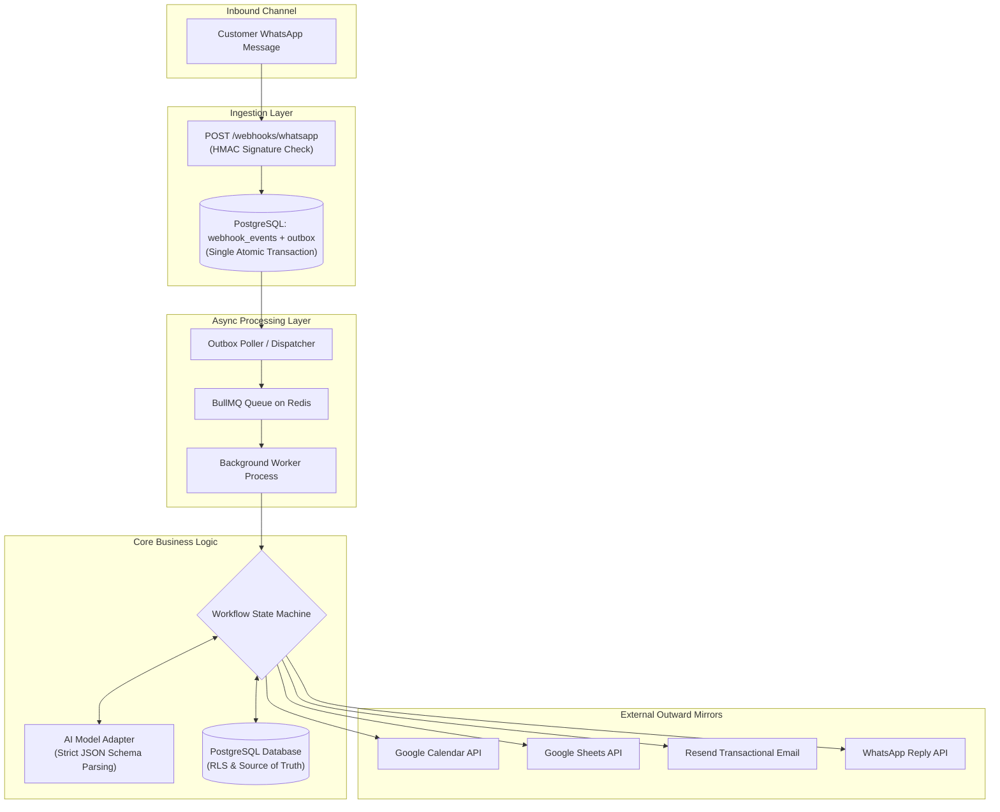
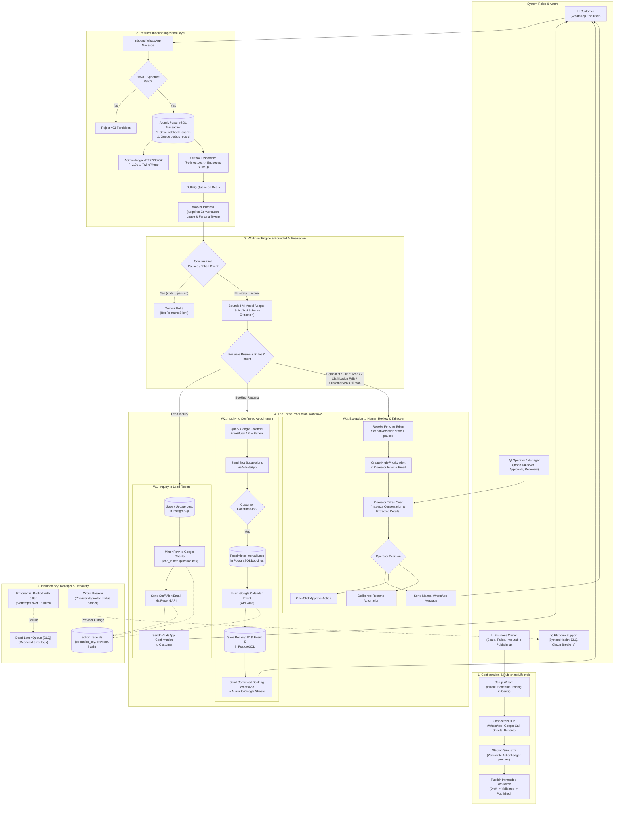
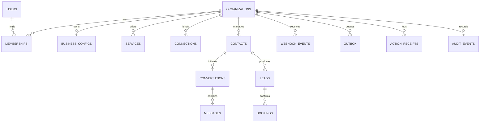

# CHECKLIST.md — Master Architecture, Data Schema & Execution Checklist

Welcome to the **Virobyte SaaS Master Execution Checklist**. This document represents the single operational tracking authority for the entire lifecycle of the SaaS product, translating the master blueprint ([`AI_Workflow_SaaS_Implementation_Guide.pdf`](file:///c:/Users/Admin/OneDrive/Desktop/virobyte-saas/docs/AI_Workflow_SaaS_Implementation_Guide.pdf)) into concrete, verifiable, full-stack features.

---

## 1. System Architecture Blueprint

The Virobyte SaaS platform is designed around the **Bounded Intelligence** architecture: Generative AI interprets unstructured customer text, while deterministic code executes state transitions, checks schedules, manages database locks, and performs external writes.



### Architectural Tiers:
1. **Frontend Dashboard (`apps/web` / React 19 + Tailwind CSS):**
   - Clean, outcome-focused interface for business owners and operators (port `3001`).
   - 4 primary sections: *Overview*, *WhatsApp Simulator*, *Services & Pricing*, *Connected Accounts*.
2. **Webhook Ingestion Endpoint (`/webhooks/whatsapp`):**
   - Cryptographically validates provider signatures (HMAC-SHA256).
   - Atomically records incoming event and outbox job in PostgreSQL; responds with HTTP `200 OK` in < 2 seconds.
3. **Transactional Outbox & Dispatcher:**
   - Guarantees zero message loss across server restarts. Moves queued outbox records to Redis BullMQ.
4. **Asynchronous Worker (`apps/worker`):**
   - Executes workflow steps, performs bounded retries with exponential backoff and jitter, manages dead-letter queue (DLQ).
5. **Bounded AI Adapter (`packages/ai`):**
   - Sends sandboxed prompts to OpenAI/Anthropic enforcing strict Zod output schemas. AI cannot execute code or invent prices.
6. **External Connectors (`packages/connectors`):**
   - Idempotent provider adapters for Twilio/WhatsApp, Google Calendar, Google Sheets, and Resend.

---

## 2. End-to-End System Flow & Role Interaction Architecture

The following diagram details the complete operational lifecycle of Virobyte SaaS, mapping every user role (**Customer**, **Business Owner**, **Operator / Manager**, and **Platform Support**) to their exact interaction paths across configuration, ingestion, bounded AI execution, the three MVP workflows (W1, W2, W3), and failure recovery.



### System Roles & Permission Boundaries

| Role | Primary Responsibilities | Access Boundaries & Permissions |
| :--- | :--- | :--- |
| **Customer** | Initiates WhatsApp inquiries, requests services, confirms suggested appointment slots, or requests a human. | Public channel only; cannot view business settings, calendar internals, or pricing rules. |
| **Business Owner** | Configures business identity, working hours, services, and pricing in minor cents; connects OAuth accounts; previews in simulator; publishes immutable workflows; manages Stripe subscription. | Full administrative access to tenant organization; cannot access data of other tenants. |
| **Manager** | Reviews pending approvals, inspects conversation inbox, updates operational settings, and monitors lead/booking volume. | Can operate conversations and review approvals; cannot change subscription billing or view raw OAuth secret credentials. |
| **Operator** | Monitors real-time Operator Inbox, takes over conversations on W3 escalation, replies directly to customers, resolves exceptions, and deliberately resumes bot automation. | Operational access only; strictly blocked from modifying connector credentials, publishing workflows, or accessing billing. |
| **Platform Support** | Monitors system health, queue latencies, circuit breakers, dead-letter queues (DLQ), and provider error rates. | System-level health access only; access to tenant conversation content or customer PII is strictly restricted, time-limited, and audited. |

### The Five Operational Execution Lifecycles

1. **Configuration & Publishing Lifecycle:**
   - The **Business Owner** answers guided onboarding questions (services, schedules, integer pricing, and service areas).
   - OAuth accounts (**WhatsApp**, **Google Calendar**, **Google Sheets**, **Resend**) are linked with encrypted credential storage.
   - Owner tests the configuration in the **Staging Simulator** (`simulatorEngine.ts`) verifying zero external writes.
   - Owner publishes: graph is compiled into an immutable `workflow_versions` row.
2. **Resilient Inbound Ingestion Lifecycle:**
   - Inbound WhatsApp webhook arrives at `POST /webhooks/whatsapp`.
   - Cryptographic HMAC-SHA256 signature is verified against provider secret.
   - Webhook event and initial outbox job are committed in a **single atomic PostgreSQL transaction**.
   - Server returns HTTP `200 OK` in < 2 seconds to satisfy Twilio/Meta SLAs.
   - The Outbox Dispatcher polls `outbox` and enqueues the job into **BullMQ on Redis**.
3. **W1: Inquiry-to-Lead Record Lifecycle:**
   - The Background Worker acquires a conversation lease with a fencing token.
   - Server-side **AI Model Adapter** extracts structured entities (`{ name, service, area, time }`) using strict Zod schemas.
   - Service and area rules are validated. Lead is persisted to PostgreSQL `leads` table.
   - Lead row is appended to the customer's **Google Sheet** using `lead_id` as the deduplication key.
   - Transactional email is dispatched to staff via **Resend API**.
   - WhatsApp confirmation message is sent to the customer within the 24-hour service window.
4. **W2: Concurrency-Safe Calendar Booking Lifecycle:**
   - Booking intent detected: system queries **Google Calendar Free/Busy API**, applies buffer minutes and business hours, and sends 2–3 slot suggestions.
   - When the customer confirms a slot, system acquires a **pessimistic PostgreSQL interval lock** (`SELECT FOR UPDATE`).
   - Re-checks Google Calendar availability to prevent external race conditions.
   - Inserts Google Calendar event via API, records `booking_id` and `external_event_id`, and mirrors booking to Google Sheets.
   - Sends booking confirmation WhatsApp message with cancellation policy details.
5. **W3: Exception Escalation & Operator Takeover Lifecycle:**
   - Triggered by complaints, unsupported services, out-of-area requests, 2 failed clarification attempts, or explicit "speak to a person" requests.
   - System immediately sets `conversations.state = 'paused'` and increments the `fencing_token`.
   - Worker checks fencing token and halts: queued AI background replies are immediately cancelled.
   - High-priority notification is dispatched to staff via email and dashboard banner.
   - **Operator** opens the conversation in the Operator Inbox, views extracted details and reason for escalation, and replies manually.
   - Automated AI processing remains silent until the operator explicitly clicks **"Resume Automation"**.

---

## 3. Complete Database Schema & Entity Relationships

All tables are hosted on **PostgreSQL (Supabase)**, use UUID primary keys, enforce `timestamptz` for dates, store money as integer minor cents, and enforce **Row-Level Security (RLS)** filtered by `org_id`.



### Core Table Definitions:

```sql
-- 1. Identity & Multi-Tenancy
CREATE TABLE organizations (
    id UUID PRIMARY KEY DEFAULT gen_random_uuid(),
    name TEXT NOT NULL,
    slug TEXT NOT NULL UNIQUE,
    timezone TEXT NOT NULL DEFAULT 'America/New_York',
    currency TEXT NOT NULL DEFAULT 'USD',
    status TEXT NOT NULL DEFAULT 'active' CHECK (status IN ('active', 'trialing', 'past_due', 'suspended')),
    created_at TIMESTAMPTZ NOT NULL DEFAULT NOW()
);

CREATE TABLE memberships (
    id UUID PRIMARY KEY DEFAULT gen_random_uuid(),
    org_id UUID NOT NULL REFERENCES organizations(id) ON DELETE CASCADE,
    user_id UUID NOT NULL REFERENCES auth.users(id) ON DELETE CASCADE,
    role TEXT NOT NULL CHECK (role IN ('owner', 'manager', 'operator', 'platform_support')),
    created_at TIMESTAMPTZ NOT NULL DEFAULT NOW(),
    UNIQUE(org_id, user_id)
);

-- 2. Business Configuration & Services
CREATE TABLE business_configs (
    id UUID PRIMARY KEY DEFAULT gen_random_uuid(),
    org_id UUID NOT NULL REFERENCES organizations(id) ON DELETE CASCADE,
    version INT NOT NULL DEFAULT 1,
    config_json JSONB NOT NULL,
    status TEXT NOT NULL DEFAULT 'published' CHECK (status IN ('draft', 'published')),
    created_by UUID REFERENCES auth.users(id),
    created_at TIMESTAMPTZ NOT NULL DEFAULT NOW()
);

CREATE TABLE services (
    id UUID PRIMARY KEY DEFAULT gen_random_uuid(),
    org_id UUID NOT NULL REFERENCES organizations(id) ON DELETE CASCADE,
    name TEXT NOT NULL,
    description TEXT,
    duration_minutes INT NOT NULL DEFAULT 120,
    buffer_minutes INT NOT NULL DEFAULT 30,
    price_minor INT NOT NULL DEFAULT 14000, -- $140.00 in integer cents
    allowed_areas TEXT[] NOT NULL DEFAULT '{}',
    active BOOLEAN NOT NULL DEFAULT TRUE,
    config_version INT NOT NULL DEFAULT 1,
    created_at TIMESTAMPTZ NOT NULL DEFAULT NOW()
);

-- 3. Connectors & External Bindings
CREATE TABLE connections (
    id UUID PRIMARY KEY DEFAULT gen_random_uuid(),
    org_id UUID NOT NULL REFERENCES organizations(id) ON DELETE CASCADE,
    provider TEXT NOT NULL CHECK (provider IN ('whatsapp', 'google_calendar', 'google_sheets', 'resend', 'stripe')),
    account_identifier TEXT,
    secret_reference TEXT, -- Encrypted vault reference (never plaintext)
    status TEXT NOT NULL DEFAULT 'connected' CHECK (status IN ('connected', 'disconnected', 'degraded', 'pending')),
    expires_at TIMESTAMPTZ,
    updated_at TIMESTAMPTZ NOT NULL DEFAULT NOW()
);

CREATE TABLE connector_bindings (
    id UUID PRIMARY KEY DEFAULT gen_random_uuid(),
    org_id UUID NOT NULL REFERENCES organizations(id) ON DELETE CASCADE,
    selected_calendar_id TEXT,
    selected_sheet_id TEXT,
    selected_sheet_tab TEXT DEFAULT 'Sheet1',
    alert_email_recipient TEXT,
    phone_number_id TEXT,
    updated_at TIMESTAMPTZ NOT NULL DEFAULT NOW(),
    UNIQUE(org_id)
);

-- 4. Customer Contacts & Conversations
CREATE TABLE contacts (
    id UUID PRIMARY KEY DEFAULT gen_random_uuid(),
    org_id UUID NOT NULL REFERENCES organizations(id) ON DELETE CASCADE,
    phone_e164 TEXT NOT NULL,
    full_name TEXT,
    consent_status TEXT NOT NULL DEFAULT 'opted_in' CHECK (consent_status IN ('opted_in', 'opted_out')),
    created_at TIMESTAMPTZ NOT NULL DEFAULT NOW(),
    UNIQUE(org_id, phone_e164)
);

CREATE TABLE conversations (
    id UUID PRIMARY KEY DEFAULT gen_random_uuid(),
    org_id UUID NOT NULL REFERENCES organizations(id) ON DELETE CASCADE,
    contact_id UUID NOT NULL REFERENCES contacts(id) ON DELETE CASCADE,
    state TEXT NOT NULL DEFAULT 'active' CHECK (state IN ('active', 'paused', 'operator_takeover', 'closed')),
    assigned_user_id UUID REFERENCES auth.users(id),
    fencing_token INT NOT NULL DEFAULT 0,
    last_inbound_at TIMESTAMPTZ NOT NULL DEFAULT NOW(),
    updated_at TIMESTAMPTZ NOT NULL DEFAULT NOW()
);

CREATE TABLE messages (
    id UUID PRIMARY KEY DEFAULT gen_random_uuid(),
    org_id UUID NOT NULL REFERENCES organizations(id) ON DELETE CASCADE,
    conversation_id UUID NOT NULL REFERENCES conversations(id) ON DELETE CASCADE,
    provider_message_id TEXT NOT NULL,
    direction TEXT NOT NULL CHECK (direction IN ('inbound', 'outbound')),
    body TEXT NOT NULL,
    delivery_state TEXT NOT NULL DEFAULT 'delivered' CHECK (delivery_state IN ('pending', 'delivered', 'read', 'failed')),
    occurred_at TIMESTAMPTZ NOT NULL DEFAULT NOW(),
    UNIQUE(org_id, provider_message_id)
);

-- 5. Business Outcomes: Leads & Bookings
CREATE TABLE leads (
    id UUID PRIMARY KEY DEFAULT gen_random_uuid(),
    org_id UUID NOT NULL REFERENCES organizations(id) ON DELETE CASCADE,
    contact_id UUID NOT NULL REFERENCES contacts(id) ON DELETE CASCADE,
    service_id UUID REFERENCES services(id),
    service_name TEXT,
    requested_area TEXT,
    details_json JSONB NOT NULL DEFAULT '{}',
    status TEXT NOT NULL DEFAULT 'new' CHECK (status IN ('new', 'contacted', 'scheduled', 'abandoned')),
    google_sheet_row_id TEXT,
    created_at TIMESTAMPTZ NOT NULL DEFAULT NOW()
);

CREATE TABLE bookings (
    id UUID PRIMARY KEY DEFAULT gen_random_uuid(),
    org_id UUID NOT NULL REFERENCES organizations(id) ON DELETE CASCADE,
    lead_id UUID REFERENCES leads(id),
    contact_id UUID NOT NULL REFERENCES contacts(id) ON DELETE CASCADE,
    service_id UUID NOT NULL REFERENCES services(id),
    starts_at TIMESTAMPTZ NOT NULL,
    ends_at TIMESTAMPTZ NOT NULL,
    status TEXT NOT NULL DEFAULT 'confirmed' CHECK (status IN ('pending_hold', 'confirmed', 'cancelled', 'rescheduled')),
    google_calendar_event_id TEXT,
    created_at TIMESTAMPTZ NOT NULL DEFAULT NOW()
);

-- 6. Resilience: Webhook Events, Outbox & Idempotency Receipts
CREATE TABLE webhook_events (
    id UUID PRIMARY KEY DEFAULT gen_random_uuid(),
    org_id UUID REFERENCES organizations(id),
    provider TEXT NOT NULL,
    provider_event_id TEXT NOT NULL,
    payload JSONB NOT NULL,
    received_at TIMESTAMPTZ NOT NULL DEFAULT NOW(),
    UNIQUE(provider, provider_event_id)
);

CREATE TABLE outbox (
    id UUID PRIMARY KEY DEFAULT gen_random_uuid(),
    org_id UUID REFERENCES organizations(id),
    event_id UUID REFERENCES webhook_events(id),
    kind TEXT NOT NULL,
    payload JSONB NOT NULL,
    status TEXT NOT NULL DEFAULT 'pending' CHECK (status IN ('pending', 'dispatched', 'failed')),
    available_at TIMESTAMPTZ NOT NULL DEFAULT NOW(),
    dispatched_at TIMESTAMPTZ
);

CREATE TABLE action_receipts (
    id UUID PRIMARY KEY DEFAULT gen_random_uuid(),
    org_id UUID NOT NULL REFERENCES organizations(id) ON DELETE CASCADE,
    operation_key TEXT NOT NULL, -- e.g. "sheet_append_lead_uuid"
    provider TEXT NOT NULL,
    external_id TEXT,
    payload_hash TEXT NOT NULL,
    status TEXT NOT NULL DEFAULT 'succeeded' CHECK (status IN ('succeeded', 'failed', 'uncertain')),
    created_at TIMESTAMPTZ NOT NULL DEFAULT NOW(),
    UNIQUE(org_id, operation_key)
);

CREATE TABLE audit_events (
    id UUID PRIMARY KEY DEFAULT gen_random_uuid(),
    org_id UUID NOT NULL REFERENCES organizations(id) ON DELETE CASCADE,
    actor_user_id UUID,
    actor_role TEXT,
    action TEXT NOT NULL,
    entity_type TEXT NOT NULL,
    entity_id TEXT NOT NULL,
    details TEXT,
    occurred_at TIMESTAMPTZ NOT NULL DEFAULT NOW()
);
```

---

## 4. External Services & Providers Directory

| Service | Provider Option | Authentication Method | Usage Scope in Virobyte SaaS |
| :--- | :--- | :--- | :--- |
| **WhatsApp Messaging** | Twilio WhatsApp API / Meta Cloud API | API Key + Auth Token / Bearer Token | Inbound webhook reception (`/webhooks/whatsapp`); outbound template and 24h window free-form replies. |
| **Calendar Scheduling** | Google Calendar API | OAuth 2.0 (`offline` access, refresh token) | Query `freeBusy` intervals, insert confirmed appointments, cancel/reschedule events. |
| **Lead Mirroring** | Google Sheets API | OAuth 2.0 (Sheets scope) | Append and update lead rows using internal `lead_id` as the unique row key. |
| **Staff Notifications** | Resend API | Bearer API Key | Dispatch transactional email alerts to staff on new lead capture or human takeover escalation. |
| **Database & Auth** | Supabase (PostgreSQL 15+) | Service Role Key (server) + Anon Key | Relational state persistence, Row-Level Security, user session management. |
| **Queue & Cache** | Upstash Redis / Redis Cloud | Redis connection URL | Powers BullMQ job queues, delayed retries, outbox dispatching, and rate limiting. |
| **AI LLM Extraction** | OpenAI API / Anthropic API | Server Bearer API Key | Structured entity extraction (`{ intent, name, service, area, time, needs_human }`). |
| **Billing & Subscriptions**| Stripe Checkout & Billing Portal | Secret Key + Webhook Signing Secret | Monthly SaaS subscription plans ($99–$199/mo), usage enforcement, customer self-serve portal. |

---

## 5. Current Implementation Progress Matrix

| Module / Component | Current Implementation Status | Notes / Location |
| :--- | :---: | :--- |
| **Design System & Base Shell** | `[x] Completed` | React 19 + TypeScript on port 3001 ([`App.tsx`](file:///c:/Users/Admin/OneDrive/Desktop/virobyte-saas/src/App.tsx), [`index.css`](file:///c:/Users/Admin/OneDrive/Desktop/virobyte-saas/src/index.css)). Transitioning to Tailwind CSS. |
| **Multi-Tenant State Modeling** | `[x] Completed` | Seeded synthetic orgs (*Sparkle & Shine*, *Apex Commercial*) in [`mockData.ts`](file:///c:/Users/Admin/OneDrive/Desktop/virobyte-saas/src/lib/mockData.ts). |
| **Role-Based Access Control (RBAC)**| `[x] Completed` | Roles (`owner`, `manager`, `operator`, `platform_support`) modeled in [`domain.ts`](file:///c:/Users/Admin/OneDrive/Desktop/virobyte-saas/src/types/domain.ts). |
| **Service Catalog & Minor Pricing** | `[x] Completed` | Interactive UI with integer cents pricing ($140.00 = 14000) in [`ServicesConfigView.tsx`](file:///c:/Users/Admin/OneDrive/Desktop/virobyte-saas/src/components/ServicesConfigView.tsx). |
| **Connector Bindings UI** | `[x] Completed` | Cards for WhatsApp, Calendar, Sheets, Resend in [`SimpleIntegrations.tsx`](file:///c:/Users/Admin/OneDrive/Desktop/virobyte-saas/src/components/SimpleIntegrations.tsx). |
| **Interactive Simulator Engine** | `[x] Completed` | High-fidelity phone preview & `ActionLedger` trace in [`SimpleAssistantTester.tsx`](file:///c:/Users/Admin/OneDrive/Desktop/virobyte-saas/src/components/SimpleAssistantTester.tsx) and [`simulatorEngine.ts`](file:///c:/Users/Admin/OneDrive/Desktop/virobyte-saas/src/lib/simulatorEngine.ts). |
| **PostgreSQL Database & Real RLS** | `[ ] Pending` | Currently in-memory React state. Needs live PostgreSQL connection and SQL migration scripts. |
| **Webhook Ingestion Endpoint** | `[ ] Pending` | Needs `/webhooks/whatsapp` endpoint with HMAC verification and transactional outbox table. |
| **BullMQ Worker & Redis** | `[ ] Pending` | Needs asynchronous queue runner to execute outbox jobs. |
| **Live AI Model Adapter** | `[-] Prototyped` | Currently regex simulated in `simulatorEngine.ts`. Needs server-side OpenAI/Anthropic Zod adapter. |
| **Live Google & Twilio APIs** | `[-] Prototyped` | Currently simulated with zero external writes. Needs OAuth 2.0 flow and live provider clients. |
| **Stripe Billing & Webhooks** | `[-] Prototyped` | Prototyped in [`BillingUsageView.tsx`](file:///c:/Users/Admin/OneDrive/Desktop/virobyte-saas/src/components/BillingUsageView.tsx). Needs live Stripe Checkout integration. |

---

## 6. Paced Sprint Schedule (Designed for Busy / Part-Time Developers)

To prevent burnout and maintain steady momentum, each sprint is allocated a realistic **2 to 3 week delivery window**:

```
Weeks 01–03: Sprint 0 (Discovery & Access Checks)
Weeks 04–06: Sprint 1 (Multi-Tenant Core & Auth Foundation)
Weeks 07–09: Sprint 2 (Guided Setup, Connectors Hub & Staging Simulator)
Weeks 10–12: Sprint 3 (Transactional Ingestion & Backend W1 Lead Capture)
Weeks 13–15: Sprint 4 (W2 Calendar Booking & W3 Human Takeover)
Weeks 16–18: Sprint 5 (Hardening, Billing & Release Acceptance)
========================================================================
★ OFFICIAL MVP LAUNCH CHECKPOINT: Product Ready to Market & Acquire Pilots ★
========================================================================
Weeks 19–21: Sprint 6 (Pilot Customer #1 Supervised Operation)
Weeks 22–24: Sprint 7 (Pilot Expansion & Commercial Renewals)
Weeks 25–27: Sprint 8 (Self-Service Setup & Friction Reduction)
Weeks 28–30: Sprint 9 (2nd Workflow Template & Rescheduling Engine)
Weeks 31–33: Sprint 10 (Bounded Workflow Editor)
Weeks 34–36: Sprint 11 (CRM Connectors Hub & Inbound Triggers)
Weeks 37–39: Sprint 12 (AI-Assisted Workflow Configuration)
Weeks 40–42: Sprint 13 (Industry Vertical Starter Packs)
Weeks 43–45: Sprint 14 (Multi-Location, Multi-Crew & Partner Management)
Weeks 46–48+: Sprint 15+ (Enterprise Scale, Document OCR & Sagas)
```

---

## 7. Granular Breakdown: Sprint -> Module -> Feature

---

### SPRINT 0: Discovery, Market Validation & Provider Access Checks
**Timeline:** Weeks 1–3 | **Phase:** Phase 0 (Iteration 0) | **Blueprint Ref:** `[Sec 04, 31]`

#### Module 0.1: Market & Workflow Validation
- [x] **Feature 0.1.1: Customer Problem Discovery & Niche Selection**
  - **Blueprint Ref:** `[Sec 01, 04]`
  - **Frontend:** N/A (Business research).
  - **Backend/DB:** Defined synthetic operational profile in [`mockData.ts`](file:///c:/Users/Admin/OneDrive/Desktop/virobyte-saas/src/lib/mockData.ts).
  - **Acceptance Gate:** Target customer locked: single-location cleaning business with shared calendar and repeatable menu. Top 5 exception workflows identified.

#### Module 0.2: Provider Technical Access Checks
- [ ] **Feature 0.2.1: WhatsApp Provider Eligibility & Sandbox Verification**
  - **Blueprint Ref:** `[Sec 13, S1]`
  - **Scope:** Create Twilio account; test WhatsApp Sandbox with test phone number; verify Tech Provider / ISV onboarding requirements for client number onboarding.
  - **Acceptance Gate:** Able to send and receive two-way WhatsApp text messages in provider sandbox.
- [ ] **Feature 0.2.2: Google Cloud Console & OAuth Verification Readiness**
  - **Blueprint Ref:** `[Sec 14, S2, S3]`
  - **Scope:** Create Google Cloud project; enable Google Calendar API and Google Sheets API; configure OAuth consent screen; verify required authorization scopes (`calendar.events`, `spreadsheets`).
  - **Acceptance Gate:** Successful local OAuth token exchange with Google APIs for calendar and sheet read/write access.
- [ ] **Feature 0.2.3: Stripe Merchant Account & Banking Verification**
  - **Blueprint Ref:** `[Sec 17, S8]`
  - **Scope:** Confirm legal operating entity eligibility in Stripe dashboard; verify test mode access for Checkout and Customer Portal.
  - **Acceptance Gate:** Stripe test mode API keys generated; test checkout session completes successfully.

---

### SPRINT 1: Multi-Tenant Core, RLS & Base Shell
**Timeline:** Weeks 4–6 | **Phase:** Phase 1 (Iteration 1) | **Blueprint Ref:** `[Sec 05, 08, 09, 16]`

#### Module 1.1: Design System & Navigation Shell
- [x] **Feature 1.1.1: Responsive Application Shell & Navigation**
  - **Blueprint Ref:** `[Sec 05]`
  - **Frontend:** Built 4-tab sidebar ([`Sidebar.tsx`](file:///c:/Users/Admin/OneDrive/Desktop/virobyte-saas/src/components/Sidebar.tsx)), top header ([`Header.tsx`](file:///c:/Users/Admin/OneDrive/Desktop/virobyte-saas/src/components/Header.tsx)), and main container ([`App.tsx`](file:///c:/Users/Admin/OneDrive/Desktop/virobyte-saas/src/App.tsx)).
  - **Styling:** Transitioning to Tailwind CSS utility styling (`slate` / `emerald` theme; dev port `3001`).
  - **Acceptance Gate:** Clean layout rendering without console errors across mobile and desktop breakpoints.

#### Module 1.2: Multi-Tenant Schema & RBAC Modeling
- [x] **Feature 1.2.1: Domain Type Contracts & Mock Data Seeding**
  - **Blueprint Ref:** `[Sec 09]`
  - **Frontend / Domain:** Structured domain models in [`domain.ts`](file:///c:/Users/Admin/OneDrive/Desktop/virobyte-saas/src/types/domain.ts) and [`mockData.ts`](file:///c:/Users/Admin/OneDrive/Desktop/virobyte-saas/src/lib/mockData.ts).
  - **Roles:** `owner`, `manager`, `operator`, `platform_support`.
  - **Acceptance Gate:** Instant tenant switching in UI header between *Sparkle & Shine* and *Apex Commercial* isolates all visible data.
- [ ] **Feature 1.2.2: Live PostgreSQL Migration & Supabase RLS Implementation**
  - **Blueprint Ref:** `[Sec 09, 16, S7]`
  - **Database:** Execute initial schema migration (`organizations`, `memberships`, `business_configs`, `services`).
  - **Security:** Enable `ALTER TABLE ... ENABLE ROW LEVEL SECURITY;` on all tables with `org_id = current_setting('app.current_org_id')`.
  - **Acceptance Gate:** Automated SQL test attempting `SELECT * FROM services WHERE org_id = 'tenant_b'` from Tenant A's session returns 0 rows.

---

### SPRINT 2: Guided Setup, Connectors Hub & Staging Simulator
**Timeline:** Weeks 7–9 | **Phase:** Phase 1 (Iteration 2) | **Blueprint Ref:** `[Sec 06, 08, 11]`

#### Module 2.1: Service Catalog & Business Configuration
- [x] **Feature 2.1.1: Service Catalog Manager with Minor Integer Pricing**
  - **Blueprint Ref:** `[Sec 06, 09]`
  - **Frontend:** Service list and modal in [`ServicesConfigView.tsx`](file:///c:/Users/Admin/OneDrive/Desktop/virobyte-saas/src/components/ServicesConfigView.tsx) with inputs for name, description, duration, buffer, price (converted to cents), and allowed zip/city areas.
  - **Validation:** Zod schema enforcement in [`schemas.ts`](file:///c:/Users/Admin/OneDrive/Desktop/virobyte-saas/src/lib/schemas.ts).
  - **Acceptance Gate:** Prices stored strictly as integer cents (e.g. `$140.00` = `14000`); negative prices rejected.

#### Module 2.2: Connector Bindings & Staging Simulator
- [x] **Feature 2.2.1: Connected Accounts Status & Destination Bindings**
  - **Blueprint Ref:** `[Sec 09, 14]`
  - **Frontend:** Integration cards for WhatsApp, Google Calendar, Google Sheets, and Resend in [`SimpleIntegrations.tsx`](file:///c:/Users/Admin/OneDrive/Desktop/virobyte-saas/src/components/SimpleIntegrations.tsx).
  - **Acceptance Gate:** Displays connection status, selected calendar ID, selected sheet ID, and alert email recipient.
- [x] **Feature 2.2.2: Interactive WhatsApp Simulator & Action Ledger Engine**
  - **Blueprint Ref:** `[Sec 11, 12]`
  - **Frontend / Engine:** Phone mockup with live messaging in [`SimpleAssistantTester.tsx`](file:///c:/Users/Admin/OneDrive/Desktop/virobyte-saas/src/components/SimpleAssistantTester.tsx) executing [`simulatorEngine.ts`](file:///c:/Users/Admin/OneDrive/Desktop/virobyte-saas/src/lib/simulatorEngine.ts).
  - **Logic:** Evaluates W1 (lead capture), W2 (appointment booking), and W3 (human escalation) in client memory.
  - **Acceptance Gate:** Zero external writes generated; all intended mutations recorded to the in-memory `ActionLedger` with unique operation keys.

---

### SPRINT 3: Transactional Ingestion & W1 (Inquiry to Lead Record)
**Timeline:** Weeks 10–12 | **Phase:** Phase 2 (Iteration 3) | **Blueprint Ref:** `[Sec 07, 10, 12, 13, 15]`

#### Module 3.1: Resilient Webhook Ingestion Engine
- [ ] **Feature 3.1.1: Cryptographic Ingestion Endpoint (`/webhooks/whatsapp`)**
  - **Blueprint Ref:** `[Sec 10, 13, S1]`
  - **Backend / API:** `POST /webhooks/whatsapp`. Validates HMAC-SHA256 signature using provider signing secret.
  - **Database:** Atomically writes incoming payload to `webhook_events` and queues a job to `outbox` in a single PostgreSQL transaction.
  - **Acceptance Gate:** Returns HTTP `200 OK` within 2 seconds; invalid signatures rejected with HTTP 403; replayed webhook payloads rejected by `(provider, provider_event_id)` uniqueness.
- [ ] **Feature 3.1.2: Transactional Outbox Dispatcher with Redis & BullMQ**
  - **Blueprint Ref:** `[Sec 08, 12, S6]`
  - **Backend / Worker:** Node.js background process polling `outbox` table, dispatching jobs to BullMQ on Redis.
  - **Resilience:** Implements exponential backoff with jitter (5 retries max over 15 minutes). Dead-letter queue for exhausted jobs.
  - **Acceptance Gate:** Worker crash mid-execution does not lose jobs; unacknowledged jobs safely re-queued by BullMQ.

#### Module 3.2: Structured AI Extraction & Production W1 Pipeline
- [ ] **Feature 3.2.1: Server-Side Bounded AI Model Adapter**
  - **Blueprint Ref:** `[Sec 08, 15]`
  - **Backend:** Server-side OpenAI/Anthropic adapter using strict Zod schema validation:
    `{ intent, customerName, serviceRequested, area, preferredTime, needsHuman }`.
  - **Security:** Strict prompt isolation: owner business rules separate from untrusted customer text.
  - **Acceptance Gate:** AI output parses into validated TypeScript types; zero prompt injections able to execute external actions.
- [ ] **Feature 3.2.2: Multi-Destination Mirroring (PostgreSQL + Sheets + Resend)**
  - **Blueprint Ref:** `[Sec 07, 14, S5]`
  - **Backend:** Upserts lead in `leads` table $\rightarrow$ appends row to customer Google Sheet using `lead_id` as key $\rightarrow$ dispatches staff alert email via Resend API $\rightarrow$ sends confirmation WhatsApp message.
  - **Acceptance Gate:** Replaying the same webhook 10 times produces exactly 1 lead in PostgreSQL, 1 row in Sheets, and 1 staff email.

---

### SPRINT 4: W2 (Appointment Booking) & W3 (Human Takeover)
**Timeline:** Weeks 13–15 | **Phase:** Phase 2 (Iteration 4) | **Blueprint Ref:** `[Sec 07, 11, 14]`

#### Module 4.1: Concurrency-Safe Calendar Booking (W2)
- [ ] **Feature 4.1.1: Availability Calculation Engine**
  - **Blueprint Ref:** `[Sec 14, S4]`
  - **Backend:** Calls Google Calendar Free/Busy API; computes open slots based on business working hours, service duration, and buffers.
  - **Acceptance Gate:** Proposes 2–3 valid slots strictly within business hours and buffer limits in customer WhatsApp reply.
- [ ] **Feature 4.1.2: Pessimistic Slot Reservation & Google Calendar Event Insert**
  - **Blueprint Ref:** `[Sec 07, 14, S4]`
  - **Backend / Database:** On slot confirmation, acquires an internal interval lock in `bookings` (`SELECT FOR UPDATE`), re-checks external Google Calendar availability, inserts Google Calendar event, and commits record.
  - **Acceptance Gate:** Two simultaneous customer requests for the same slot cannot both receive a confirmation; second caller receives alternative slot suggestions.

#### Module 4.2: Human Escalation & Operator Takeover (W3)
- [ ] **Feature 4.2.1: Automated Bot Pause & Escalation Triggers**
  - **Blueprint Ref:** `[Sec 07, 11]`
  - **Backend:** Triggers on complaints, out-of-area requests, 2 failed clarification attempts, or explicit "human/person" requests.
  - **Database:** Sets `conversations.state = 'paused'`, cancels queued AI messages, and revokes conversation fencing token.
  - **Acceptance Gate:** Once paused, inbound customer messages do not trigger automated AI replies.
- [ ] **Feature 4.2.2: Real-Time Operator Takeover Inbox**
  - **Blueprint Ref:** `[Sec 05, 10]`
  - **Frontend:** Operator inbox displaying active conversation, extracted details, and operator controls: **Manual Reply**, **Take Over**, **Pause**, **Approve Action**, **Resume Bot**.
  - **Acceptance Gate:** Operator sending a manual reply updates conversation status and keeps the bot silent until deliberate resume.

---

### SPRINT 5: Reliability Hardening, Billing & Release Acceptance
**Timeline:** Weeks 16–18 | **Phase:** Phase 2 (Iteration 5) | **Blueprint Ref:** `[Sec 12, 17, 18, 25]`

#### Module 5.1: Action Receipts & Reliability Hardening
- [ ] **Feature 5.1.1: Action Receipts Ledger & Idempotency Enforcement**
  - **Blueprint Ref:** `[Sec 11, 12]`
  - **Database:** Logs every outward API action into `action_receipts` with unique `operation_key`.
  - **Acceptance Gate:** Repeated execution of an identical action key returns existing receipt with zero duplicate API calls.
- [ ] **Feature 5.1.2: Provider Circuit Breakers & Dead-Letter Dashboard**
  - **Blueprint Ref:** `[Sec 12, 18]`
  - **Backend / Frontend:** Circuit breaker opens on repeated third-party API failures; surfaces degraded-status warning banner in dashboard.
  - **Acceptance Gate:** External provider outage pauses affected outbound actions without crashing worker process.

#### Module 5.2: Stripe Subscription Billing & Entitlements
- [ ] **Feature 5.2.1: Stripe Checkout & Webhook Entitlement Sync**
  - **Blueprint Ref:** `[Sec 17, S8]`
  - **Backend / API:** `POST /api/billing/checkout` redirects to Stripe hosted checkout; `POST /webhooks/billing` processes subscription updates.
  - **Acceptance Gate:** Subscription payment failure activates grace period banner; active subscriptions grant full automation execution.
- [ ] **Feature 5.2.2: 100-Case AI Regression Evaluation Harness**
  - **Blueprint Ref:** `[Sec 15, 25]`
  - **Testing:** Automated evaluation test suite running 100 synthetic customer inquiries (normal, typos, dates, complaints, prompt injections).
  - **Acceptance Gate:** Minimum **95% field extraction accuracy**; **zero unauthorized actions** in adversarial prompt injection tests.

---

```
========================================================================================
★ OFFICIAL MVP LAUNCH CHECKPOINT: The Core Paid MVP is complete and ready to market,
   onboard initial cleaning businesses, and test willingness to renew before proceeding
   to post-MVP expansion sprints. ★
========================================================================================
```

---

### SPRINT 6: Supervised Paid Pilot #1
**Timeline:** Weeks 19–21 | **Phase:** Phase 3 (Iteration 6) | **Blueprint Ref:** `[Sec 21]`

#### Module 6.1: Pilot Customer #1 Deployment
- [ ] **Feature 6.1.1: Production Deployment & Supervised Mode**
  - **Blueprint Ref:** `[Sec 21]`
  - **Scope:** Deploy production web and worker containers. Onboard Pilot Business #1 in **Supervised Mode** (outward WhatsApp messages queue for 1-click staff approval).
  - **Acceptance Gate:** Customer #1 successfully processes 25+ real customer inquiries with zero duplicate bookings.

---

### SPRINT 7: Multi-Tenant Pilot Expansion & Renewal Gate
**Timeline:** Weeks 22–24 | **Phase:** Phase 3 (Iteration 7) | **Blueprint Ref:** `[Sec 21, 27]`

#### Module 7.1: Multi-Customer Pilot Operations
- [ ] **Feature 7.1.1: Pilot Expansion to 3–5 Businesses & Business ROI Digest**
  - **Blueprint Ref:** `[Sec 21, 27]`
  - **Scope:** Onboard 2 additional cleaning businesses; generate automated weekly owner digest showing hours saved and leads captured.
  - **Acceptance Gate:** At least 3 paying businesses; >= 95% technical success rate across >= 100 runs; at least 2 businesses renew at commercial rates ($99–$199/mo).

---

### SPRINT 8: Self-Service Setup & Friction Reduction
**Timeline:** Weeks 25–27 | **Phase:** Phase 4 (Iteration 8) | **Blueprint Ref:** `[Sec 22]`

#### Module 8.1: Official Provider Embedded Onboarding
- [ ] **Feature 8.1.1: Official WhatsApp Embedded Signup & Authorization UX**
  - **Blueprint Ref:** `[Sec 13, 22, S1]`
  - **Frontend:** Provider embedded signup modal for Meta / Twilio Tech Provider onboarding; live permission scopes checklist; visual indicator of phone number status (`VERIFIED`, `PENDING_REVIEW`, `LIVE`).
  - **Backend / API:** `GET /api/connections/whatsapp/embedded-session` generating signed launch tokens; `POST /api/connections/whatsapp/embedded-callback` exchanging auth code for permanent credentials.
  - **Database:** Stores provider account, WABA ID, and phone number identifier into `connections` with encrypted credential reference.
  - **Acceptance Gate:** Non-technical owner links live WhatsApp Business number through official UI without developer CLI intervention.
- [ ] **Feature 8.1.2: One-Click Setup Diagnostics & Interactive Test Generator**
  - **Blueprint Ref:** `[Sec 22]`
  - **Frontend:** Setup Health Checklist displaying live connectivity status of WhatsApp, Google Calendar, Sheets, and Resend; "Generate Test Inquiry" button with pre-filled scenarios.
  - **Backend / API:** `POST /api/connections/diagnostics/ping` running read/write verification on all 4 connectors; returns actionable error repairs (e.g. "OAuth token expired: click Re-authorize").
  - **Database:** Logs diagnostic test results in `audit_events`.
  - **Acceptance Gate:** 1-click test inquiry completes end-to-end simulation in < 3 seconds with visual confirmation banners.

#### Module 8.2: Setup Telemetry & Workflow Change History
- [ ] **Feature 8.2.1: Onboarding Funnel Telemetry & Stall Tracking**
  - **Blueprint Ref:** `[Sec 22, 27]`
  - **Frontend:** Telemetry trackers attached to onboarding wizard transitions.
  - **Backend / API:** `POST /api/analytics/events` logging immutable funnel milestones: `setup_started`, `oauth_connected`, `test_passed`, `activated`, `stall_detected`.
  - **Database:** Stored in `usage_events` with tenant UUID and timestamp.
  - **Acceptance Gate:** Owner drop-off points (e.g. stalled on Google OAuth) captured in metrics without recording personal message contents.
- [ ] **Feature 8.2.2: Workflow Change History & Revert Engine**
  - **Blueprint Ref:** `[Sec 11, 22]`
  - **Frontend:** Version history timeline drawer showing published workflow versions, publishing author, timestamp, and visual diff of changed rules.
  - **Backend / API:** `GET /api/workflows/versions` and `POST /api/workflows/{id}/revert`.
  - **Database:** Sets active `workflow_versions.status = 'published'`, archiving current; running workflows continue on their pinned version.
  - **Acceptance Gate:** Reverting to Version 1 immediately applies V1 rules to new inbound runs without affecting active in-flight conversations.

---

### SPRINT 9: 2nd Workflow Template & Rescheduling Engine
**Timeline:** Weeks 28–30 | **Phase:** Phase 4 (Iteration 9) | **Blueprint Ref:** `[Sec 22]`

#### Module 9.1: 2nd Workflow Template (Quotation & Recurring Cleaning)
- [ ] **Feature 9.1.1: Multi-Room Custom Quotation Intake Form**
  - **Blueprint Ref:** `[Sec 02, 22]`
  - **Frontend:** Intake wizard in WhatsApp and public web form (`/forms/{token}`) collecting bedroom count, bathroom count, square footage, and deep-clean extras (oven, fridge, interior windows).
  - **Backend / API:** Dynamic formula calculation: `total_minor = base_fee + (bedrooms * room_rate) + (bathrooms * bath_rate) + extras_minor`.
  - **Database:** Extends `business_configs.config_json` with `quotation_rules` schema; stores generated quote in `leads.details_json`.
  - **Acceptance Gate:** AI extracts room count from WhatsApp message, executes deterministic pricing formula, and returns exact breakdown quote.
- [ ] **Feature 9.1.2: Recurring Service Frequency Engine & Discount Rules**
  - **Blueprint Ref:** `[Sec 22]`
  - **Frontend:** Configuration controls for recurring intervals (Weekly: 20% off, Bi-Weekly: 15% off, Monthly: 10% off).
  - **Backend / API:** Evaluates customer frequency choice, applies percentage discounts strictly via integer arithmetic, formats recurring booking schedules.
  - **Database:** Appends `frequency: 'weekly' | 'bi-weekly' | 'monthly'` to `leads` and `bookings`.
  - **Acceptance Gate:** Confirmed recurring booking creates initial calendar reservation with recurring cadence metadata recorded in Google Sheets.

#### Module 9.2: Customer Rescheduling & Cancellation Engine
- [ ] **Feature 9.2.1: Inbound Cancellation / Reschedule Intent Parser & Auth**
  - **Blueprint Ref:** `[Sec 22]`
  - **Backend / AI:** Detects customer phrases like "I need to cancel tomorrow" or "Can we move my 2pm appointment?". Authenticates identity by matching inbound WhatsApp phone number against active `bookings.contact_id`.
  - **Business Rules:** Checks `business_configs.cancellationPolicyHours` (e.g. 24h cutoff). If within cutoff, routes to W3 operator review.
  - **Acceptance Gate:** Unmatched phone numbers or out-of-policy late cancellations halt automation and alert staff; valid requests proceed.
- [ ] **Feature 9.2.2: Concurrency-Safe Calendar Slot Modification & Receipting**
  - **Blueprint Ref:** `[Sec 12, 14, 22]`
  - **Backend:** Releases existing Google Calendar event via `events.delete` or `events.patch`, recalculates availability, acquires interval lock on new slot, updates `bookings` record, logs `action_receipts`.
  - **Acceptance Gate:** Reschedule frees up old slot immediately on Google Calendar; customer receives confirmation WhatsApp message; Sheets mirror row updated.

---

### SPRINT 10: Bounded Workflow Editor
**Timeline:** Weeks 31–33 | **Phase:** Phase 5 (Iteration 10) | **Blueprint Ref:** `[Sec 11, 23]`

#### Module 10.1: Visual Step-List Editor UI
- [ ] **Feature 10.1.1: Reorderable Action Step-List Builder**
  - **Blueprint Ref:** `[Sec 11, 23]`
  - **Frontend:** Step-list canvas in `apps/web` allowing owners to reorder registered action blocks: `message_trigger`, `condition`, `extract_fields`, `save_record`, `check_availability`, `reserve_booking`, `send_message`, `send_email`, `approval`, `finish`.
  - **UI Controls:** Drag handle, step configuration drawer, step deletion guard.
  - **Acceptance Gate:** Reordering steps updates the execution sequence; incompatible node connections visually blocked.
- [ ] **Feature 10.1.2: Type-Safe Field Mapping Interface**
  - **Blueprint Ref:** `[Sec 11, 23]`
  - **Frontend:** Field mapper component displaying upstream outputs (e.g. `customerName`, `extractedService`) with type badges (`string`, `number`, `boolean`) and destination inputs.
  - **Validation:** Blocks assigning mismatched types (e.g. string into integer duration).
  - **Acceptance Gate:** Visual validator highlights missing required upstream fields before saving draft.

#### Module 10.2: Graph Compilation & Pre-Publish Validator
- [ ] **Feature 10.2.1: Static Graph Validator & Reachability Engine**
  - **Blueprint Ref:** `[Sec 11, 23]`
  - **Backend / API:** `POST /api/workflows/validate`. Performs cycle detection, verifies every path reaches `finish`, checks that required external connectors exist and are active.
  - **Acceptance Gate:** Malformed graphs or unconfigured destinations return explicit `field_errors` JSON array; valid graphs compile to immutable JSON.
- [ ] **Feature 10.2.2: Workflow Sandbox Dry-Run Runner**
  - **Blueprint Ref:** `[Sec 11, 23]`
  - **Frontend / Backend:** Allows owner to run simulated test cases against the newly authored graph before publishing; renders step-by-step visual trace.
  - **Acceptance Gate:** Step-by-step execution highlights active nodes on screen without performing real database mutations or outbound API writes.

---

### SPRINT 11: CRM Connectors Hub & Inbound Triggers
**Timeline:** Weeks 34–36 | **Phase:** Phase 5 (Iteration 11) | **Blueprint Ref:** `[Sec 14, 23]`

#### Module 11.1: CRM Integration Adapters
- [ ] **Feature 11.1.1: HubSpot OAuth & Deal Sync Connector**
  - **Blueprint Ref:** `[Sec 23]`
  - **Backend / Connectors:** `HubSpotConnector` implementing OAuth 2.0 exchange, contact upsert (`/crm/v3/objects/contacts`), and deal creation (`/crm/v3/objects/deals`).
  - **Database:** Stores HubSpot tokens in `connections`; stores `hubspot_contact_id` in `contacts`.
  - **Acceptance Gate:** Confirmed appointment in W2 creates or updates matching contact and deal in HubSpot pipeline with lead value in cents.
- [ ] **Feature 11.2.2: Pipedrive Lead & Activity Connector**
  - **Blueprint Ref:** `[Sec 23]`
  - **Backend / Connectors:** `PipedriveConnector` implementing API token authentication, person creation, and scheduled activity creation.
  - **Acceptance Gate:** Inbound qualified lead creates Pipedrive Person and scheduled activity assigned to sales pipeline.

#### Module 11.2: Inbound Email Triggers & Connector Registry
- [ ] **Feature 11.2.3: Inbound Email Webhook Ingestion Engine**
  - **Blueprint Ref:** `[Sec 10, 23]`
  - **Backend / API:** `POST /webhooks/email/inbound` parsing incoming emails (SendGrid Inbound Parse / Postmark). Extracts sender, subject, plain text body, strips email signatures.
  - **Database:** Atomically writes to `webhook_events` and queues outbox job.
  - **Acceptance Gate:** Inbound customer email triggers W1 extraction workflow identical to WhatsApp message.
- [ ] **Feature 11.2.4: Standardized Connector Registry & Rate Limiter**
  - **Blueprint Ref:** `[Sec 12, 23]`
  - **Backend:** Central registry declaring adapter metadata: scopes, auth type, rate limits, retry policies, and health check endpoints.
  - **Resilience:** Per-tenant and per-provider concurrency limiters preventing quota exhaustion.
  - **Acceptance Gate:** Exceeding provider rate limits pauses outbound dispatch and queues jobs for delayed retry with `Retry-After` header honored.

---

### SPRINT 12: AI-Assisted Workflow Configuration
**Timeline:** Weeks 37–39 | **Phase:** Phase 5 (Iteration 12) | **Blueprint Ref:** `[Sec 15, 23]`

#### Module 12.1: Natural Language Workflow Drafter
- [ ] **Feature 12.1.1: Plain-Language Prompt to Action-Graph Compiler**
  - **Blueprint Ref:** `[Sec 15, 23]`
  - **Frontend:** Natural language prompt input: *"Build a workflow for move-out cleaning: ask bedrooms, verify Manhattan area, send quote, book calendar, notify Sarah"*.
  - **Backend / AI:** Server-side LLM compiler with registered actions prompt sandboxing. Compiles prompt into structured JSON workflow graph.
  - **Safety Rule:** AI can ONLY assemble pre-registered node types; CANNOT create arbitrary code or grant unapproved tool permissions.
  - **Acceptance Gate:** Compiles valid JSON graph matching registered schema; unsupported requests cleanly rejected.
- [ ] **Feature 12.1.2: Interactive Assumptions Review & Owner Approval**
  - **Blueprint Ref:** `[Sec 15, 23]`
  - **Frontend:** Diff modal displaying AI assumptions: proposed steps, required inputs, destination accounts, and escalation rules.
  - **Acceptance Gate:** Graph remains in `draft` status until owner clicks "Approve & Publish"; unconfirmed AI drafts never run in production.

---

### SPRINT 13: Industry Vertical Starter Packs
**Timeline:** Weeks 40–42 | **Phase:** Phase 6 (Iteration 13) | **Blueprint Ref:** `[Sec 24]`

#### Module 13.1: Vertical Industry Templates
- [ ] **Feature 13.1.1: Handyman & Repair Service Intake Pack**
  - **Blueprint Ref:** `[Sec 24]`
  - **Scope:** Pre-configured template for emergency vs routine repairs, problem description extraction, photo upload prompt, hourly quote estimation.
  - **Frontend / Data:** Seed data, specialized FAQ knowledge base, and booking buffer rules.
  - **Acceptance Gate:** New handyman tenant activates full repair intake workflow in under 5 minutes without writing custom prompts.
- [ ] **Feature 13.1.2: Real Estate & Property Inquiry Pack**
  - **Blueprint Ref:** `[Sec 24]`
  - **Scope:** Rental property inquiry template, viewing tour appointment booking, tenant qualification questions (move-in date, pet status, budget).
  - **Acceptance Gate:** Inbound WhatsApp inquiry qualifies prospective tenant and schedules apartment showing into property manager's calendar.

---

### SPRINT 14: Multi-Location, Multi-Crew & Partner Management
**Timeline:** Weeks 43–45 | **Phase:** Phase 6 (Iteration 14) | **Blueprint Ref:** `[Sec 24]`

#### Module 14.1: Multi-Location & Multi-Crew Scheduling
- [ ] **Feature 14.1.1: Multi-Location Branch Management & Geofencing**
  - **Blueprint Ref:** `[Sec 24]`
  - **Frontend / Backend:** Support multiple locations per organization. Each branch defines its own working hours, service area zip codes, and assigned calendar.
  - **Database:** Adds `locations` table (`id`, `org_id`, `name`, `timezone`, `zip_codes`, `calendar_resource_id`).
  - **Acceptance Gate:** Customer area routes booking strictly to the correct branch's calendar without cross-location booking conflicts.
- [ ] **Feature 14.1.2: Multi-Crew Capacity Modeling & Resource Dispatch**
  - **Blueprint Ref:** `[Sec 24]`
  - **Backend:** Models team capacity (e.g. 3 cleaning crews available concurrently). Extends slot availability algorithm to check aggregate capacity.
  - **Acceptance Gate:** System allows up to N simultaneous bookings for identical time slots where N = active crews; blocks the (N+1)th attempt.

#### Module 14.2: Partner Agency Portal & Template Marketplace
- [ ] **Feature 14.2.1: Partner Agency Dashboard & Multi-Client Management**
  - **Blueprint Ref:** `[Sec 24]`
  - **Frontend / Backend:** Agency view to manage multiple client sub-accounts; switch between client workspaces with audit logging; per-client billing breakdown.
  - **Security:** Strict cross-tenant boundaries enforced; Agency A cannot view Agency B's clients.
  - **Acceptance Gate:** Agency staff seamlessly deploys validated workflow template to 5 client accounts with one click.
- [ ] **Feature 14.2.2: Curated Template Marketplace**
  - **Blueprint Ref:** `[Sec 24]`
  - **Frontend / Backend:** Marketplace gallery of community and verified templates; review process; version compatibility verification.
  - **Acceptance Gate:** Tenants can clone verified marketplace templates into their draft workspace with security scan validation.

---

### SPRINT 15+: Enterprise Scale, Document Processing & Reversible Sagas
**Timeline:** Weeks 46–48+ | **Phase:** Phase 7 (Iteration 15+) | **Blueprint Ref:** `[Sec 24]`

#### Module 15.1: Document OCR & Enterprise Security
- [ ] **Feature 15.1.1: Inbound Document & Image Extraction Pipeline**
  - **Blueprint Ref:** `[Sec 24]`
  - **Backend / AI:** Processes images and PDFs uploaded via WhatsApp or public forms (utility bills, lease agreements). Performs malware scan, extracts key fields via Vision AI with bounding boxes.
  - **Security:** Consequential fields require human operator confirmation before committing to database.
  - **Acceptance Gate:** Corrupted or malicious uploads quarantined; valid documents extract structured fields with operator confirmation.
- [ ] **Feature 15.2.2: Enterprise SSO & Custom RBAC Policies**
  - **Blueprint Ref:** `[Sec 16, 24]`
  - **Backend / Auth:** SAML 2.0 / OIDC enterprise Single Sign-On (Okta, Azure AD). Custom role builder with fine-grained action permissions.
  - **Acceptance Gate:** Enterprise tenant members authenticate via corporate IdP with SCIM provisioning.

#### Module 15.2: Self-Healing Workflows & Reversible Sagas
- [ ] **Feature 15.2.3: Saga Execution & Compensation Engine**
  - **Blueprint Ref:** `[Sec 12, 24]`
  - **Backend / Engine:** Implements the Saga pattern for multi-step distributed operations (e.g. Calendar event + CRM deal + Stripe charge). If step 3 fails after retries, triggers compensating rollback actions (e.g. cancels calendar hold, removes draft deal).
  - **Acceptance Gate:** Simulated failure at step 3 automatically executes rollback transactions leaving zero phantom holds across external providers.
- [ ] **Feature 15.2.4: Autonomous Process Optimization Advisor**
  - **Blueprint Ref:** `[Sec 24, 27]`
  - **Backend / AI:** Analyzes historical booking conversion funnels, response latencies, and drop-off points. Generates weekly actionable recommendations (e.g. "Adding a 30-min buffer on Friday afternoons reduced operator escalations by 40%").
  - **Acceptance Gate:** Optimization suggestions saved as drafts for owner review; system never mutates live production business rules autonomously.
