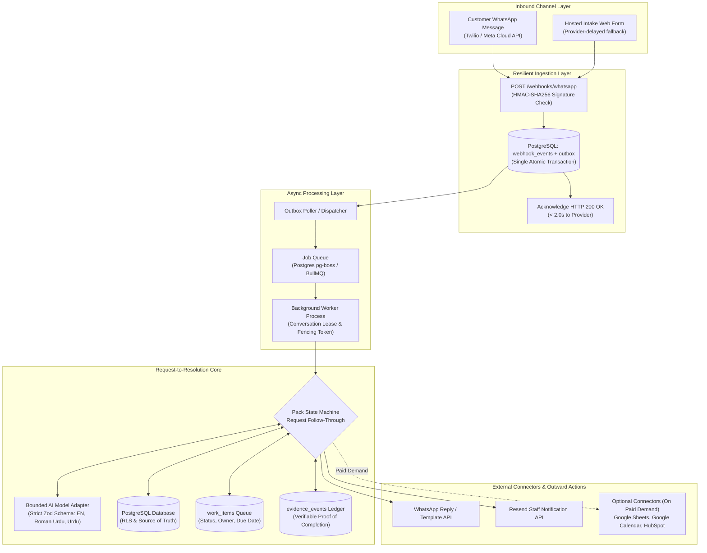
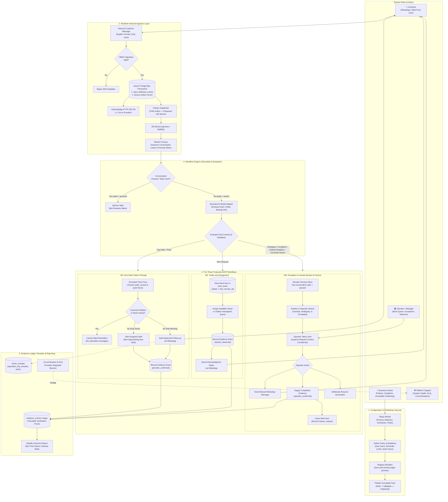
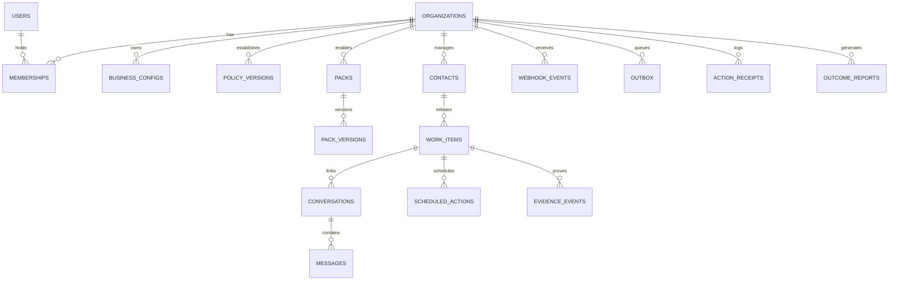

# CHECKLIST.md — Master Architecture, Data Schema & Execution Checklist

Welcome to the **Virobyte SaaS Master Execution Checklist**. This document represents the single operational tracking authority for the entire lifecycle of the SaaS product, translating the master blueprint ([`AI_Workflow_SaaS_Implementation_Guide_v4.pdf`](file:///c:/Users/Admin/OneDrive/Desktop/virobyte-saas/docs/AI_Workflow_SaaS_Implementation_Guide_v4.pdf) — Version 4.0 | 10 October 2026) into concrete, verifiable, full-stack features.

---

## 1. System Architecture Blueprint

The Virobyte SaaS platform is designed around the **Request-to-Resolution Core**: every incoming customer message becomes tracked work with an owner, a due date, and visible completion evidence. The system adheres strictly to the **Bounded Intelligence** architecture: Generative AI interprets unstructured customer text across English, Roman Urdu, and Urdu script, while deterministic code executes state transitions, deadlines, durable timers, database locks, and external actions.



### Architectural Tiers:
1. **Frontend Dashboard (`apps/web` / React 19 + Tailwind CSS):**
   - Clean, outcome-focused interface for business owners and operators (port `3001`).
   - 5 primary views: *Work Queue* (overdue/unassigned first), *Item Timeline*, *Approvals & Exceptions*, *Connections*, and *Results & Usage* (Net Time Saved).
2. **Webhook Ingestion Endpoint (`/webhooks/whatsapp`):**
   - Cryptographically validates provider signatures (HMAC-SHA256).
   - Atomically records incoming event and outbox job in PostgreSQL; responds with HTTP `200 OK` in < 2 seconds.
3. **Transactional Outbox & Dispatcher:**
   - Guarantees zero message loss across server restarts. Moves queued outbox records to the durable job queue.
4. **Asynchronous Worker (`apps/worker`):**
   - Executes workflow steps, acquires short conversation leases with fencing tokens, manages durable timers, and handles dead-letter queues (DLQ).
5. **Bounded AI Adapter (`packages/ai`):**
   - Sends sandboxed prompts to OpenAI/Anthropic enforcing strict Zod output schemas. Supports English, Roman Urdu, and Urdu script. AI cannot execute code or invent completion events.
6. **Core Work-Item & Evidence Ledger:**
   - PostgreSQL is the authoritative system of record for `work_items` and `evidence_events`. Defer Redis, microservices, and graph editors until measured need justifies them.

---

## 2. End-to-End System Flow & Role Interaction Architecture

The following diagram details the complete operational lifecycle of Virobyte SaaS, mapping every user role (**Customer**, **Business Owner**, **Operator / Manager**, and **Platform Support**) to their exact interaction paths across configuration, ingestion, bounded AI execution, the three MVP workflows (W1, W2, W3), and failure recovery.



### System Roles & Permission Boundaries

| Role | Primary Responsibilities | Access Boundaries & Permissions |
| :--- | :--- | :--- |
| **Customer** | Initiates requests via WhatsApp or web form, answers clarification questions, provides status inquiries, requests human. | Public channel only; cannot view work queues, internal deadlines, or pricing settings. |
| **Business Owner** | Configures workspace, selects pack, sets deadlines and reminder rules, publishes immutable versions, manages subscription tier (USD / PKR). | Full administrative access to tenant organization; strictly blocked from other tenants. |
| **Manager** | Supervises the active work queue, monitors overdue/blocked items, reassigns owners, reviews pending approvals. | Can manage work items and operator assignments; cannot modify billing or view raw OAuth credentials. |
| **Operator** | Works assigned queue items, takes over on W3 escalation, replies manually, resolves exceptions, supplies closure evidence. | Operational queue access only; strictly blocked from modifying pack schemas, publishing, or billing. |
| **Platform Support** | Monitors system health, queue ages, DLQ errors, and circuit breakers. | Technical health access only; temporary access to customer message content is explicitly approved, time-limited, and audited. |

### The Five Operational Execution Lifecycles

1. **Configuration & Publishing Lifecycle:**
   - The **Business Owner** selects a process pack (*Request Follow-through*) and defines business hours, timezone, and required fields.
   - Owner configures deadlines, reminder limits (e.g. up to 2 reminders over 7 days), quiet hours, and escalation roster.
   - Owner tests normal and failure cases in the **Staging Simulator** verifying zero external side effects.
   - Owner reviews permissions and publishes an immutable `pack_versions` row.
2. **Resilient Inbound Ingestion Lifecycle:**
   - Inbound message arrives at `POST /webhooks/whatsapp`.
   - HMAC-SHA256 signature is verified against provider secret.
   - Raw payload and outbox job are committed in a **single atomic PostgreSQL transaction**.
   - Server returns HTTP `200 OK` in < 2 seconds to satisfy provider SLAs.
   - The Outbox Dispatcher moves pending records to the durable job queue.
3. **W1: Intake and Assignment Lifecycle:**
   - The Background Worker acquires a conversation lease with a fencing token.
   - Server-side **AI Model Adapter** extracts structured fields across English, Roman Urdu, or Urdu script with max 2 clarification rounds.
   - System saves a new record in `work_items` with an assigned deadline (`due_at`).
   - Work item is assigned to an available operator or placed in the visible unassigned work queue.
   - An immutable `evidence_events` record is logged with verification level `system_observed`.
   - Customer receives an automated WhatsApp acknowledgment within the 24-hour service window.
4. **W2: Due-Date Follow-Through Lifecycle:**
   - A persisted timer carrying the expected `state_version` fires when follow-up is due.
   - Worker reloads latest state, checks consent, quiet hours, and 24-hour message window.
   - If the customer already replied or the item was closed, the stale timer is cancelled immediately.
   - If information remains missing, sends an approved follow-up template or alerts assigned staff.
   - All external dispatch events generate `action_receipts` to prevent duplicate messaging.
5. **W3: Exception Escalation & Closure Lifecycle:**
   - Triggered by ambiguity, customer complaints, unsupported actions, expired deadlines, or uncertain provider results.
   - System immediately sets `conversations.state = 'paused'` and increments the `fencing_token` to halt background AI sends.
   - Item moves to the top of the **Work Queue** marked with urgency badge.
   - **Operator** takes over in the dashboard, reviews full context, and replies manually.
   - Work item is marked completed only when an authorized operator or trusted system supplies **verifiable evidence**.

---

## 3. Complete Database Schema & Entity Relationships

All tables are hosted on **PostgreSQL (Supabase)**, use UUID primary keys, enforce `timestamptz` for dates, store money as integer minor units with currency, and enforce **Row-Level Security (RLS)** filtered by `org_id`.



### Core Table Definitions:

```sql
-- 1. Identity & Multi-Tenancy
CREATE TABLE organizations (
    id UUID PRIMARY KEY DEFAULT gen_random_uuid(),
    name TEXT NOT NULL,
    slug TEXT NOT NULL UNIQUE,
    timezone TEXT NOT NULL DEFAULT 'Asia/Karachi',
    currency TEXT NOT NULL DEFAULT 'PKR' CHECK (currency IN ('PKR', 'USD')),
    tier TEXT NOT NULL DEFAULT 'local_pkr' CHECK (tier IN ('global_usd', 'local_pkr')),
    status TEXT NOT NULL DEFAULT 'active' CHECK (status IN ('active', 'trialing', 'past_due', 'suspended')),
    created_at TIMESTAMPTZ NOT NULL DEFAULT NOW()
);

CREATE TABLE memberships (
    id UUID PRIMARY KEY DEFAULT gen_random_uuid(),
    org_id UUID NOT NULL REFERENCES organizations(id) ON DELETE CASCADE,
    user_id UUID NOT NULL REFERENCES auth.users(id) ON DELETE CASCADE,
    role TEXT NOT NULL CHECK (role IN ('owner', 'manager', 'operator', 'platform_support')),
    created_at TIMESTAMPTZ NOT NULL DEFAULT NOW(),
    UNIQUE(org_id, user_id)
);

-- 2. Configuration & Policy Versions
CREATE TABLE business_configs (
    id UUID PRIMARY KEY DEFAULT gen_random_uuid(),
    org_id UUID NOT NULL REFERENCES organizations(id) ON DELETE CASCADE,
    version INT NOT NULL DEFAULT 1,
    config_json JSONB NOT NULL,
    status TEXT NOT NULL DEFAULT 'published' CHECK (status IN ('draft', 'published')),
    created_by UUID REFERENCES auth.users(id),
    created_at TIMESTAMPTZ NOT NULL DEFAULT NOW()
);

CREATE TABLE policy_versions (
    id UUID PRIMARY KEY DEFAULT gen_random_uuid(),
    org_id UUID NOT NULL REFERENCES organizations(id) ON DELETE CASCADE,
    version INT NOT NULL DEFAULT 1,
    deadline_hours INT NOT NULL DEFAULT 24,
    reminder_rules_json JSONB NOT NULL DEFAULT '{"max_reminders": 2, "interval_days": 3}',
    quiet_hours_json JSONB NOT NULL DEFAULT '{"start": "21:00", "end": "09:00"}',
    escalation_roster_json JSONB NOT NULL DEFAULT '[]',
    created_at TIMESTAMPTZ NOT NULL DEFAULT NOW()
);

-- 3. Packs & Versioned Templates
CREATE TABLE packs (
    id UUID PRIMARY KEY DEFAULT gen_random_uuid(),
    name TEXT NOT NULL,
    slug TEXT NOT NULL UNIQUE,
    description TEXT,
    active BOOLEAN NOT NULL DEFAULT TRUE,
    created_at TIMESTAMPTZ NOT NULL DEFAULT NOW()
);

CREATE TABLE pack_versions (
    id UUID PRIMARY KEY DEFAULT gen_random_uuid(),
    pack_id UUID NOT NULL REFERENCES packs(id) ON DELETE CASCADE,
    version INT NOT NULL DEFAULT 1,
    field_schema_json JSONB NOT NULL,
    completion_contract_json JSONB NOT NULL,
    allowed_actions TEXT[] NOT NULL DEFAULT '{}',
    created_at TIMESTAMPTZ NOT NULL DEFAULT NOW(),
    UNIQUE(pack_id, version)
);

-- 4. Contacts & Identities
CREATE TABLE contacts (
    id UUID PRIMARY KEY DEFAULT gen_random_uuid(),
    org_id UUID NOT NULL REFERENCES organizations(id) ON DELETE CASCADE,
    phone_e164 TEXT NOT NULL,
    full_name TEXT,
    language_preference TEXT NOT NULL DEFAULT 'en' CHECK (language_preference IN ('en', 'roman_urdu', 'urdu')),
    consent_status TEXT NOT NULL DEFAULT 'opted_in' CHECK (consent_status IN ('opted_in', 'opted_out')),
    created_at TIMESTAMPTZ NOT NULL DEFAULT NOW(),
    UNIQUE(org_id, phone_e164)
);

CREATE TABLE channel_identities (
    id UUID PRIMARY KEY DEFAULT gen_random_uuid(),
    org_id UUID NOT NULL REFERENCES organizations(id) ON DELETE CASCADE,
    contact_id UUID NOT NULL REFERENCES contacts(id) ON DELETE CASCADE,
    channel TEXT NOT NULL DEFAULT 'whatsapp' CHECK (channel IN ('whatsapp', 'web_form', 'email')),
    external_identifier TEXT NOT NULL,
    created_at TIMESTAMPTZ NOT NULL DEFAULT NOW(),
    UNIQUE(org_id, channel, external_identifier)
);

-- 5. Primary Object: Work Items & Conversations
CREATE TABLE work_items (
    id UUID PRIMARY KEY DEFAULT gen_random_uuid(),
    org_id UUID NOT NULL REFERENCES organizations(id) ON DELETE CASCADE,
    pack_id UUID REFERENCES packs(id),
    type TEXT NOT NULL DEFAULT 'request_follow_through',
    status TEXT NOT NULL DEFAULT 'new' CHECK (status IN ('new', 'awaiting_information', 'ready', 'in_progress', 'awaiting_approval', 'blocked', 'completed', 'cancelled', 'dormant')),
    owner_id UUID REFERENCES auth.users(id),
    contact_id UUID NOT NULL REFERENCES contacts(id) ON DELETE CASCADE,
    due_at TIMESTAMPTZ,
    next_action_at TIMESTAMPTZ,
    state_version INT NOT NULL DEFAULT 1,
    policy_version INT NOT NULL DEFAULT 1,
    closure_reason TEXT,
    data_json JSONB NOT NULL DEFAULT '{}',
    created_at TIMESTAMPTZ NOT NULL DEFAULT NOW(),
    updated_at TIMESTAMPTZ NOT NULL DEFAULT NOW()
);

CREATE TABLE conversations (
    id UUID PRIMARY KEY DEFAULT gen_random_uuid(),
    org_id UUID NOT NULL REFERENCES organizations(id) ON DELETE CASCADE,
    work_item_id UUID NOT NULL REFERENCES work_items(id) ON DELETE CASCADE,
    contact_id UUID NOT NULL REFERENCES contacts(id) ON DELETE CASCADE,
    state TEXT NOT NULL DEFAULT 'active' CHECK (state IN ('active', 'paused', 'operator_takeover', 'closed')),
    assigned_user_id UUID REFERENCES auth.users(id),
    fencing_token INT NOT NULL DEFAULT 0,
    last_inbound_at TIMESTAMPTZ NOT NULL DEFAULT NOW(),
    updated_at TIMESTAMPTZ NOT NULL DEFAULT NOW()
);

CREATE TABLE messages (
    id UUID PRIMARY KEY DEFAULT gen_random_uuid(),
    org_id UUID NOT NULL REFERENCES organizations(id) ON DELETE CASCADE,
    conversation_id UUID NOT NULL REFERENCES conversations(id) ON DELETE CASCADE,
    provider_message_id TEXT NOT NULL,
    direction TEXT NOT NULL CHECK (direction IN ('inbound', 'outbound')),
    body TEXT NOT NULL,
    delivery_state TEXT NOT NULL DEFAULT 'delivered' CHECK (delivery_state IN ('pending', 'delivered', 'read', 'failed')),
    occurred_at TIMESTAMPTZ NOT NULL DEFAULT NOW(),
    UNIQUE(org_id, provider_message_id)
);

-- 6. Execution, Timers & Idempotency Receipts
CREATE TABLE webhook_events (
    id UUID PRIMARY KEY DEFAULT gen_random_uuid(),
    org_id UUID REFERENCES organizations(id),
    provider TEXT NOT NULL,
    provider_event_id TEXT NOT NULL,
    payload JSONB NOT NULL,
    received_at TIMESTAMPTZ NOT NULL DEFAULT NOW(),
    UNIQUE(provider, provider_event_id)
);

CREATE TABLE outbox (
    id UUID PRIMARY KEY DEFAULT gen_random_uuid(),
    org_id UUID REFERENCES organizations(id),
    event_id UUID REFERENCES webhook_events(id),
    kind TEXT NOT NULL,
    payload JSONB NOT NULL,
    status TEXT NOT NULL DEFAULT 'pending' CHECK (status IN ('pending', 'dispatched', 'failed')),
    available_at TIMESTAMPTZ NOT NULL DEFAULT NOW(),
    dispatched_at TIMESTAMPTZ
);

CREATE TABLE scheduled_actions (
    id UUID PRIMARY KEY DEFAULT gen_random_uuid(),
    org_id UUID NOT NULL REFERENCES organizations(id) ON DELETE CASCADE,
    work_item_id UUID NOT NULL REFERENCES work_items(id) ON DELETE CASCADE,
    action_type TEXT NOT NULL,
    due_at TIMESTAMPTZ NOT NULL,
    expected_state_version INT NOT NULL,
    payload_json JSONB NOT NULL DEFAULT '{}',
    status TEXT NOT NULL DEFAULT 'pending' CHECK (status IN ('pending', 'executed', 'cancelled')),
    created_at TIMESTAMPTZ NOT NULL DEFAULT NOW()
);

CREATE TABLE action_receipts (
    id UUID PRIMARY KEY DEFAULT gen_random_uuid(),
    org_id UUID NOT NULL REFERENCES organizations(id) ON DELETE CASCADE,
    operation_key TEXT NOT NULL,
    provider TEXT NOT NULL,
    external_id TEXT,
    payload_hash TEXT NOT NULL,
    status TEXT NOT NULL DEFAULT 'succeeded' CHECK (status IN ('succeeded', 'failed', 'uncertain')),
    created_at TIMESTAMPTZ NOT NULL DEFAULT NOW(),
    UNIQUE(org_id, operation_key)
);

CREATE TABLE approvals (
    id UUID PRIMARY KEY DEFAULT gen_random_uuid(),
    org_id UUID NOT NULL REFERENCES organizations(id) ON DELETE CASCADE,
    work_item_id UUID NOT NULL REFERENCES work_items(id) ON DELETE CASCADE,
    payload_hash TEXT NOT NULL,
    recipient TEXT,
    amount_minor INT,
    expires_at TIMESTAMPTZ NOT NULL,
    decision TEXT NOT NULL DEFAULT 'pending' CHECK (decision IN ('pending', 'approved', 'rejected')),
    decided_by UUID REFERENCES auth.users(id),
    decided_at TIMESTAMPTZ
);

-- 7. Evidence Ledger & Outcome Reports (Blueprint Sections 11 & 17)
CREATE TABLE evidence_events (
    id UUID PRIMARY KEY DEFAULT gen_random_uuid(),
    org_id UUID NOT NULL REFERENCES organizations(id) ON DELETE CASCADE,
    work_item_id UUID NOT NULL REFERENCES work_items(id) ON DELETE CASCADE,
    event_type TEXT NOT NULL,
    source_ref TEXT NOT NULL,
    actor TEXT NOT NULL,
    verification_level TEXT NOT NULL CHECK (verification_level IN ('system_observed', 'provider_confirmed', 'customer_reported', 'operator_confirmed')),
    payload_json JSONB NOT NULL DEFAULT '{}',
    occurred_at TIMESTAMPTZ NOT NULL DEFAULT NOW()
);

CREATE TABLE outcome_reports (
    id UUID PRIMARY KEY DEFAULT gen_random_uuid(),
    org_id UUID NOT NULL REFERENCES organizations(id) ON DELETE CASCADE,
    period_start TIMESTAMPTZ NOT NULL,
    period_end TIMESTAMPTZ NOT NULL,
    eligible_count INT NOT NULL DEFAULT 0,
    completed_count INT NOT NULL DEFAULT 0,
    overdue_count INT NOT NULL DEFAULT 0,
    net_time_saved_minutes INT NOT NULL DEFAULT 0,
    cost_minor INT NOT NULL DEFAULT 0,
    currency TEXT NOT NULL DEFAULT 'PKR',
    created_at TIMESTAMPTZ NOT NULL DEFAULT NOW()
);

CREATE TABLE connections (
    id UUID PRIMARY KEY DEFAULT gen_random_uuid(),
    org_id UUID NOT NULL REFERENCES organizations(id) ON DELETE CASCADE,
    provider TEXT NOT NULL CHECK (provider IN ('whatsapp', 'resend', 'stripe', 'google_calendar', 'google_sheets')),
    account_identifier TEXT,
    secret_reference TEXT,
    status TEXT NOT NULL DEFAULT 'connected' CHECK (status IN ('connected', 'disconnected', 'degraded', 'pending')),
    expires_at TIMESTAMPTZ,
    updated_at TIMESTAMPTZ NOT NULL DEFAULT NOW()
);

CREATE TABLE audit_events (
    id UUID PRIMARY KEY DEFAULT gen_random_uuid(),
    org_id UUID NOT NULL REFERENCES organizations(id) ON DELETE CASCADE,
    actor_user_id UUID,
    actor_role TEXT,
    action TEXT NOT NULL,
    entity_type TEXT NOT NULL,
    entity_id TEXT NOT NULL,
    details TEXT,
    occurred_at TIMESTAMPTZ NOT NULL DEFAULT NOW()
);
```

---

## 4. External Services & Providers Directory

| Service | Provider Option | Authentication Method | Usage Scope in Virobyte SaaS |
| :--- | :--- | :--- | :--- |
| **WhatsApp Messaging** | Twilio WhatsApp API / Meta Cloud API | API Key + Auth Token / Bearer Token | Inbound webhook reception (`/webhooks/whatsapp`); outbound template and 24h window free-form replies. |
| **Hosted Intake Form** | Next.js Server Actions / App Router | Tokenized Session (`/forms/{token}`) | Standard fallback inbound channel when WhatsApp business verification is pending. |
| **Staff Notifications** | Resend API | Bearer API Key | Dispatch transactional email alerts to staff on new work items or overdue escalations. |
| **Database & Auth** | Supabase (PostgreSQL 15+) | Service Role Key (server) + Anon Key | Relational state persistence, Row-Level Security, user session management. |
| **Job Queue & Timers** | PostgreSQL (`pg-boss`) / BullMQ + Redis | PostgreSQL Connection / Redis URL | Durable job processing, scheduled timers, outbox dispatching, and retries. |
| **AI LLM Extraction** | OpenAI API / Anthropic API | Server Bearer API Key | Structured entity extraction with strict Zod validation across English, Roman Urdu, and Urdu script. |
| **Billing & Invoicing** | Manual Invoicing (PKR/USD) + Stripe | Bank Transfer Records / Stripe Secret Key | Manual invoicing for Pakistani local tier (PKR); Stripe Checkout & Portal for USD global tier. |
| **Optional Adapters** *(On Paid Demand)* | Google Calendar, Google Sheets, HubSpot | OAuth 2.0 (Scoped permissions) | Released only when paying pilot customers explicitly require calendar reservation or spreadsheet sync. |

---

## 5. Current Implementation Progress Matrix

| Module / Component | Current Implementation Status | Notes / Location |
| :--- | :---: | :--- |
| **Design System & Base Shell** | `[x] Completed` | React 19 + TypeScript on port 3001 ([`App.tsx`](file:///c:/Users/Admin/OneDrive/Desktop/virobyte-saas/src/App.tsx), [`index.css`](file:///c:/Users/Admin/OneDrive/Desktop/virobyte-saas/src/index.css)). Transitioning to Tailwind CSS. |
| **Multi-Tenant State Modeling** | `[x] Completed` | Seeded synthetic orgs (*Sparkle & Shine*, *Apex Commercial*) in [`mockData.ts`](file:///c:/Users/Admin/OneDrive/Desktop/virobyte-saas/src/lib/mockData.ts). |
| **Role-Based Access Control (RBAC)**| `[x] Completed` | Roles (`owner`, `manager`, `operator`, `platform_support`) modeled in [`domain.ts`](file:///c:/Users/Admin/OneDrive/Desktop/virobyte-saas/src/types/domain.ts). |
| **Process Configuration UI** | `[x] Completed` | Interactive UI with integer minor pricing in [`ServicesConfigView.tsx`](file:///c:/Users/Admin/OneDrive/Desktop/virobyte-saas/src/components/ServicesConfigView.tsx). |
| **Connector Bindings UI** | `[x] Completed` | Channel and connector cards in [`SimpleIntegrations.tsx`](file:///c:/Users/Admin/OneDrive/Desktop/virobyte-saas/src/components/SimpleIntegrations.tsx). |
| **Interactive Simulator Engine** | `[x] Completed` | High-fidelity preview & `ActionLedger` trace in [`SimpleAssistantTester.tsx`](file:///c:/Users/Admin/OneDrive/Desktop/virobyte-saas/src/components/SimpleAssistantTester.tsx) and [`simulatorEngine.ts`](file:///c:/Users/Admin/OneDrive/Desktop/virobyte-saas/src/lib/simulatorEngine.ts). |
| **PostgreSQL Database & Real RLS** | `[ ] Pending` | Currently in-memory React state. Needs live PostgreSQL connection and SQL migration scripts. |
| **Webhook Ingestion Endpoint** | `[ ] Pending` | Needs `/webhooks/whatsapp` endpoint with HMAC verification and transactional outbox table. |
| **Durable Worker & Timers** | `[ ] Pending` | Needs asynchronous queue runner (`pg-boss` or BullMQ) to execute outbox jobs and timers. |
| **Live AI Model Adapter** | `[-] Prototyped` | Currently regex simulated in `simulatorEngine.ts`. Needs server-side LLM Zod adapter for EN/Roman Urdu. |
| **Evidence Ledger & Reports** | `[ ] Pending` | Needs `evidence_events` table and Net Time Saved weekly reporting engine. |
| **Manual Billing / Stripe** | `[-] Prototyped` | Prototyped in [`BillingUsageView.tsx`](file:///c:/Users/Admin/OneDrive/Desktop/virobyte-saas/src/components/BillingUsageView.tsx). Needs manual ledger & Stripe integration. |

---

## 6. Paced Sprint Schedule (Designed for Busy / Part-Time Developers)

Based on the **three-founder capacity model** (Blueprint Section 23), each sprint is allocated a realistic **2 to 3 week delivery window** totaling 17 weeks for the reduced MVP:

```
Weeks 01–03: Sprint 0 (Scored Discovery & Concierge Pilots)
Weeks 04–06: Sprint 1 (Tenant Foundation & One Adapter - Iteration A)
Weeks 07–09: Sprint 2 (Pack Configuration & Staging Simulation - Iteration B)
Weeks 10–12: Sprint 3 (Real Intake & Work-Item Creation - Iteration C)
Weeks 13–15: Sprint 4 (Due-Date Follow-Through & Operator Control - Iteration D)
Weeks 16–18: Sprint 5 (Hardening, Reporting & Supervised Rollout - Iteration E)
========================================================================================
★ OFFICIAL MVP LAUNCH CHECKPOINT: Request-to-Resolution Core Verified for Live Pilots ★
========================================================================================
Weeks 19–21: Sprint 6 (Pilot Customer #1 Supervised Operation & Baseline Tracking)
Weeks 22–24: Sprint 7 (Multi-Customer Pilot Expansion & Commercial Renewals)
Weeks 25–27: Sprint 8 (Self-Service Setup & Friction Reduction)
Weeks 28–30: Sprint 9 (2nd Process Pack: Quote Follow-Up / Client Onboarding)
Weeks 31–33: Sprint 10 (Bounded Pack & Step Configuration Editor)
Weeks 34–36: Sprint 11 (CRM & External System Connectors on Paid Demand)
Weeks 37–39: Sprint 12 (AI-Assisted Pack Configuration)
Weeks 40–42: Sprint 13 (Industry Vertical Presets: Repair & Quote Firms)
Weeks 43–45: Sprint 14 (Multi-Location, Multi-Crew & Partner Management)
Weeks 46–48+: Sprint 15+ (Enterprise Scale, Document OCR & Sagas)
```

---

## 7. Granular Breakdown: Sprint -> Module -> Feature

---

### SPRINT 0: Scored Discovery & Concierge Pilots
**Timeline:** Weeks 1–3 | **Phase:** Phase 0 (Iteration 0) | **Blueprint Ref:** `[Sec 05, 12, 14, 15, 30]`

#### Module 0.1: Scored Discovery Interviews
- [ ] **Feature 0.1.1: Scored Segment Interviews (Segment A vs Segment B)**
  - **Blueprint Ref:** `[Sec 05, 30]`
  - **Scope:** Conduct 10 structured interviews (5 with device repair shops, 5 with quote-driven service firms). Score each 1 to 5 across 9 criteria (double-weighting willingness to pay and repeatability, max 45 points).
  - **Decision Rule:** Pick the segment with higher weighted score and at least 2 prospects willing to discuss a paid pilot.
  - **Acceptance Gate:** Scored interview sheet completed with evidence notes; single winning segment locked.
- [ ] **Feature 0.1.2: Baseline Loss Rate & Handling Time Measurement**
  - **Blueprint Ref:** `[Sec 11, 14, 15]`
  - **Scope:** Walk through last 10 requests with target prospects: where they arrived, how long staff spent chasing missing info, and how many went cold.
  - **Acceptance Gate:** Document baseline metrics: average handling minutes per request and baseline loss percentage (must exceed 5% to justify value).

#### Module 0.2: Provider Checks & Pilot Commitments
- [ ] **Feature 0.2.1: WhatsApp Provider Eligibility & Sandbox Verification**
  - **Blueprint Ref:** `[Sec 19, R4, R5]`
  - **Scope:** Verify Twilio WhatsApp API / Meta Cloud API onboarding for Pakistani / international legal entities; test two-way messaging in sandbox.
  - **Acceptance Gate:** Working sandbox channel; documented per-message pass-through pricing ($0.005 + Meta fee).
- [ ] **Feature 0.2.2: Concierge Pilot Agreements & Pricing Confirmation**
  - **Blueprint Ref:** `[Sec 12, 14, 15]`
  - **Scope:** Present pilot terms in writing: Global Tier ($300 setup + $199 pilot fee) or Local Tier (PKR 10,000 setup + PKR 8,000 pilot fee); 150 work items; 2 hours support.
  - **Acceptance Gate:** Secure **3 paid pilot commitments** with one agreed repeatable process.

---

### SPRINT 1: Tenant Foundation & One Adapter (Iteration A)
**Timeline:** Weeks 4–6 | **Phase:** Phase 1 (Iteration A) | **Blueprint Ref:** `[Sec 10, 16, 17, 24]`

#### Module 1.1: Application Shell & Five Primary Views
- [ ] **Feature 1.1.1: Five Primary Views Layout & Navigation**
  - **Blueprint Ref:** `[Sec 10]`
  - **Frontend:** Build navigation layout in `apps/web`: *Work Queue*, *Item Timeline*, *Approvals & Exceptions*, *Connections*, *Results & Usage*.
  - **Design Rules:** Tailwind CSS (`slate` canvas, `emerald` accents, port `3001`); visually distinguish manual vs automated actions.
  - **Acceptance Gate:** Responsive layout rendering all 5 views with empty and loading states.
- [ ] **Feature 1.1.2: Synthetic Tenant Attack Test Suite**
  - **Blueprint Ref:** `[Sec 16, 21, 24]`
  - **Testing:** Seed two synthetic tenants (*Sparkle & Shine* and *Apex Commercial*); execute automated test suite attempting cross-tenant reads and mutations.
  - **Acceptance Gate:** Tenant A cannot access, query, or execute work items belonging to Tenant B; operator role blocked from publishing.

#### Module 1.2: PostgreSQL Multi-Tenant Schema & RLS
- [ ] **Feature 1.2.1: Core Identity & Work-Item Tables Migration**
  - **Blueprint Ref:** `[Sec 17]`
  - **Database:** Execute SQL migration creating `organizations`, `memberships`, `business_configs`, `policy_versions`, `work_items`, and `contacts`.
  - **Security:** Enable Row-Level Security (`ALTER TABLE ... ENABLE ROW LEVEL SECURITY;`) enforcing `org_id` on every query.
  - **Acceptance Gate:** Direct SQL queries without matching tenant session return 0 rows.

---

### SPRINT 2: Pack Configuration & Staging Simulation (Iteration B)
**Timeline:** Weeks 7–9 | **Phase:** Phase 1 (Iteration B) | **Blueprint Ref:** `[Sec 07, 10, 18, 24]`

#### Module 2.1: Pack Schema & Deadline Policy Engine
- [ ] **Feature 2.1.1: Request Follow-Through Pack Definition & Schemas**
  - **Blueprint Ref:** `[Sec 07, 10]`
  - **Frontend / Backend:** Build configuration form in `apps/web` for the *Request Follow-through pack*: business hours, timezone, required fields, and owner assignment rules.
  - **Validation:** Zod schema validation ensuring non-negative prices, valid IANA timezones, and valid quiet hours ranges.
  - **Acceptance Gate:** Configuration compiles to immutable JSON; invalid inputs return descriptive field errors.
- [ ] **Feature 2.1.2: Staging Simulator & Action Ledger Engine**
  - **Blueprint Ref:** `[Sec 18, 24]`
  - **Frontend / Engine:** Phone mockup test sandbox executing [`simulatorEngine.ts`](file:///c:/Users/Admin/OneDrive/Desktop/virobyte-saas/src/lib/simulatorEngine.ts) in memory.
  - **Logic:** Evaluates W1 intake, W2 timers, and W3 exception triggers with zero external writes.
  - **Acceptance Gate:** Simulator records all intended actions to an in-memory `ActionLedger` with unique operation keys.

---

### SPRINT 3: Real Intake & Work-Item Creation (Iteration C)
**Timeline:** Weeks 10–12 | **Phase:** Phase 2 (Iteration C) | **Blueprint Ref:** `[Sec 08, 09, 17, 19, 20, 24]`

#### Module 3.1: Cryptographic Ingestion & Transactional Outbox
- [ ] **Feature 3.1.1: Verified Inbound Webhook Endpoint (`/webhooks/whatsapp`)**
  - **Blueprint Ref:** `[Sec 17, 19, R4]`
  - **Backend / API:** `POST /webhooks/whatsapp`. Cryptographically validates provider signature (HMAC-SHA256).
  - **Database:** Atomically writes incoming payload to `webhook_events` and queues job in `outbox` in a single PostgreSQL transaction.
  - **Acceptance Gate:** Returns HTTP `200 OK` in < 2 seconds; replayed payloads rejected by `(provider, provider_event_id)` uniqueness.
- [ ] **Feature 3.1.2: Transactional Outbox Dispatcher & Durable Job Queue**
  - **Blueprint Ref:** `[Sec 16, 18]`
  - **Backend / Worker:** Long-running worker process polling `outbox` table, dispatching jobs to PostgreSQL job queue (`pg-boss` or BullMQ).
  - **Resilience:** Implements bounded exponential backoff with jitter (5 retries max over 15 minutes). Dead-letter queue for exhausted jobs.
  - **Acceptance Gate:** Worker crash mid-execution does not lose jobs; unacknowledged jobs safely re-queued.

#### Module 3.2: Multi-Language AI Extraction & Work Item Creation (W1)
- [ ] **Feature 3.2.1: Server-Side Bounded AI Model Adapter (EN, Roman Urdu, Urdu)**
  - **Blueprint Ref:** `[Sec 20]`
  - **Backend:** Server-side OpenAI/Anthropic model adapter enforcing strict Zod output schema:
    `{ intent, customerName, extractedFields, missingFields, languageDetected, needsHuman }`.
  - **Language Gates:** Evaluates English, Roman Urdu (e.g. *"bhai kal tak phone ready ho jaye ga?"*), and Urdu script.
  - **Acceptance Gate:** >= 95% extraction accuracy on representative 100-case test set; zero unauthorized actions.
- [ ] **Feature 3.2.2: W1 Work Item Creation & Traceable Assignment**
  - **Blueprint Ref:** `[Sec 09, 11]`
  - **Backend / Database:** Resolves contact identity $\rightarrow$ checks for existing open item $\rightarrow$ inserts record in `work_items` with calculated `due_at` $\rightarrow$ assigns to owner or unassigned queue.
  - **Evidence:** Logs `evidence_events` record with verification level `system_observed`. Sends confirmation WhatsApp reply.
  - **Acceptance Gate:** Repeated delivery of the same message produces exactly one work item and no duplicate staff alerts.

---

### SPRINT 4: Due-Date Follow-Through & Operator Control (Iteration D)
**Timeline:** Weeks 13–15 | **Phase:** Phase 2 (Iteration D) | **Blueprint Ref:** `[Sec 09, 10, 18, 20, 24]`

#### Module 4.1: Durable Timers & Due-Date Follow-Through (W2)
- [ ] **Feature 4.1.1: Persisted Timer Scheduling Engine**
  - **Blueprint Ref:** `[Sec 18]`
  - **Backend / Queue:** Schedules delayed jobs carrying expected `work_item_id` and `state_version`.
  - **Validation:** When timer fires, re-checks customer replies, opt-out status, quiet hours, and remaining reminder budget.
  - **Cancellation Rule:** Customer reply or status change automatically invalidates stale scheduled sends.
  - **Acceptance Gate:** Customer replying before the timer fires cancels the automated follow-up.
- [ ] **Feature 4.1.2: W2 Follow-Through Notification & Staff Escalation**
  - **Blueprint Ref:** `[Sec 09, 18]`
  - **Backend:** If required info is still missing, sends approved follow-up WhatsApp message (up to 2 reminders over 7 days). If deadline nears without completion, escalates to assigned staff.
  - **Acceptance Gate:** Logs `action_receipts` with unique operation key; never sends messages during quiet hours.

#### Module 4.2: Exception Escalation & Operator Takeover (W3)
- [ ] **Feature 4.2.1: Automated Bot Pause & Fencing Token Revocation**
  - **Blueprint Ref:** `[Sec 09, 18]`
  - **Backend:** Triggers on ambiguity, complaint, unsupported action, or customer asking for a person.
  - **Database:** Increments `conversations.fencing_token` and sets `conversations.state = 'paused'`.
  - **Acceptance Gate:** Revoking the fencing token immediately blocks queued background AI sends from being dispatched.
- [ ] **Feature 4.2.2: Real-Time Work Queue & Operator Takeover Interface**
  - **Blueprint Ref:** `[Sec 10]`
  - **Frontend:** Work queue putting overdue and blocked items first. Operator controls: **Manual Reply**, **Take Over**, **Supply Evidence**, **Close Item**, **Resume Automation**.
  - **Acceptance Gate:** Operator taking over keeps the bot silent until deliberate resume control is clicked.

---

### SPRINT 5: Hardening, Reporting & Supervised Rollout (Iteration E)
**Timeline:** Weeks 16–18 | **Phase:** Phase 2 (Iteration E) | **Blueprint Ref:** `[Sec 11, 13, 22, 24, 25]`

#### Module 5.1: Action Receipts, DLQ & Reliability Hardening
- [ ] **Feature 5.1.1: Action Receipts Ledger & Idempotency Enforcement**
  - **Blueprint Ref:** `[Sec 18]`
  - **Database:** Logs every outward API mutation into `action_receipts` with `(org_id, operation_key)`.
  - **Acceptance Gate:** Repeated execution returns existing receipt with zero duplicate provider calls.
- [ ] **Feature 5.1.2: Provider Circuit Breakers & Dead-Letter Dashboard**
  - **Blueprint Ref:** `[Sec 18, 22]`
  - **Backend / Frontend:** Opens circuit breaker on sustained provider errors (>5% over 15 mins); displays degraded-status banner in dashboard; dead-letter queue view for operators.
  - **Acceptance Gate:** Provider outage pauses affected outbound actions without crashing worker process.

#### Module 5.2: Evidence-Linked Weekly Reporting & Pilot Invoicing
- [ ] **Feature 5.2.1: Evidence-Linked Weekly Outcome Report & Net Time Saved**
  - **Blueprint Ref:** `[Sec 11, 13, 14]`
  - **Backend / Frontend:** Generates weekly report in `Results & Usage`: eligible requests, completed items, overdue items, escalation rate, and **Net Time Saved** (`baseline_minutes - current_human_minutes`).
  - **Auditability:** Every metric number links directly to underlying verified records in `evidence_events`.
  - **Acceptance Gate:** Report clearly displays net time saved; unverified items excluded from completion counts.
- [ ] **Feature 5.2.2: Manual Invoicing, Entitlement Controls & 100-Case Evaluation**
  - **Blueprint Ref:** `[Sec 12, 20, 22]`
  - **Backend:** Record plan, period, item allowance (150 pilot items), and manual bank transfer invoices. Alert at 80% usage.
  - **Evaluation Harness:** Run automated 100-case regression suite (typos, Roman Urdu, prompt injection, complaints).
  - **Acceptance Gate:** Minimum **95% field extraction accuracy**; zero unauthorized actions; backup restore drill verified in staging.

---

```
========================================================================================
★ OFFICIAL MVP LAUNCH CHECKPOINT: The Request-to-Resolution Core MVP is verified
   and ready to onboard initial cleaning/repair businesses for supervised pilot operations. ★
========================================================================================
```

---

### SPRINT 6: Supervised Pilot Operation & Baseline Tracking
**Timeline:** Weeks 19–21 | **Phase:** Phase 3 (Iteration 6) | **Blueprint Ref:** `[Sec 15, 23]`

#### Module 6.1: Customer #1 Supervised Deployment
- [ ] **Feature 6.1.1: Production Deployment & Supervised Mode Rollout**
  - **Blueprint Ref:** `[Sec 15, 23]`
  - **Scope:** Deploy production web and worker containers. Onboard Pilot Customer #1 in **Supervised Mode** (outward WhatsApp messages queue for 1-click staff approval).
  - **Acceptance Gate:** Customer #1 successfully processes 25+ real customer inquiries with zero duplicate work items.
- [ ] **Feature 6.1.2: Daily Failure Triage & Procedure Hardening**
  - **Blueprint Ref:** `[Sec 15, 23]`
  - **Scope:** Conduct daily review of all conversation logs and work items with business owner. Categorize extraction errors, update pack rules, and record manual founder support minutes.
  - **Acceptance Gate:** Zero unhandled failure modes; transition from Supervised Mode to Autonomous Mode after 3 days of 100% accuracy.

---

### SPRINT 7: Multi-Customer Pilot Expansion & Renewal Gate
**Timeline:** Weeks 22–24 | **Phase:** Phase 3 (Iteration 7) | **Blueprint Ref:** `[Sec 12, 13, 15, 27]`

#### Module 7.1: Multi-Customer Pilot Operations & Commercial Renewals
- [ ] **Feature 7.1.1: Pilot Expansion to 3–5 Businesses & Cohort Monitoring**
  - **Blueprint Ref:** `[Sec 15, 27]`
  - **Scope:** Onboard 2 additional businesses; track queue latency, provider fees, and support minutes across the cohort.
  - **Acceptance Gate:** At least 3 paying businesses; >= 95% technical success rate across >= 100 eligible runs.
- [ ] **Feature 7.1.2: Commercial Renewal Gate & Unit Economics Validation**
  - **Blueprint Ref:** `[Sec 12, 13, 27]`
  - **Scope:** Conduct formal pilot review meeting with all 3 owners. Present weekly outcome reports and secure ongoing subscriptions ($299/mo USD or PKR 12,000/mo).
  - **Acceptance Gate:** At least 2 of 3 businesses renew at commercial rates; gross contribution margin >= 70%.

---

### SPRINT 8: Self-Service Setup & Friction Reduction
**Timeline:** Weeks 25–27 | **Phase:** Phase 4 (Iteration 8) | **Blueprint Ref:** `[Sec 10, 22]`

#### Module 8.1: Official Provider Embedded Onboarding
- [ ] **Feature 8.1.1: Official WhatsApp Embedded Signup UX**
  - **Blueprint Ref:** `[Sec 19, R4]`
  - **Frontend:** Provider embedded signup modal for Meta / Twilio Tech Provider onboarding; live permission scopes checklist; visual indicator of phone number status (`VERIFIED`, `LIVE`).
  - **Backend / API:** `GET /api/connections/whatsapp/embedded-session` generating launch tokens; `POST /api/connections/whatsapp/embedded-callback` exchanging auth code.
  - **Database:** Stores WABA ID and phone number identifier in `connections` with encrypted credential reference.
  - **Acceptance Gate:** Owner links live WhatsApp number through official UI without developer CLI intervention.
- [ ] **Feature 8.1.2: Setup Diagnostics & 1-Click Verification Ping**
  - **Blueprint Ref:** `[Sec 10, 22]`
  - **Frontend:** Setup Health Checklist displaying live connectivity status of WhatsApp and web forms; "Generate Test Request" button with pre-filled scenarios.
  - **Backend / API:** `POST /api/connections/diagnostics/ping` running read/write verification on active channels; returns actionable error repairs.
  - **Acceptance Gate:** 1-click test inquiry completes end-to-end simulation in < 3 seconds with visual confirmation banners.

#### Module 8.2: Onboarding Telemetry & Pack Change History
- [ ] **Feature 8.2.1: Onboarding Funnel Telemetry & Stall Tracking**
  - **Blueprint Ref:** `[Sec 22, 28]`
  - **Frontend:** Telemetry trackers attached to onboarding wizard transitions.
  - **Backend / API:** `POST /api/analytics/events` logging immutable funnel milestones: `setup_started`, `channel_connected`, `test_passed`, `activated`.
  - **Acceptance Gate:** Onboarding drop-off points captured in metrics without recording personal message contents; onboarding labor < 2 founder hours.
- [ ] **Feature 8.2.2: Pack Change History & Revert Engine**
  - **Blueprint Ref:** `[Sec 10, 22]`
  - **Frontend:** Version history timeline drawer showing published pack versions, author, timestamp, and visual diff of changed rules.
  - **Backend / API:** `GET /api/packs/versions` and `POST /api/packs/{id}/revert`.
  - **Acceptance Gate:** Reverting to Version 1 applies V1 rules to new inbound requests without affecting active in-flight items.

---

### SPRINT 9: 2nd Process Pack (Quote Follow-Up / Client Onboarding)
**Timeline:** Weeks 28–30 | **Phase:** Phase 4 (Iteration 9) | **Blueprint Ref:** `[Sec 07, 27]`

#### Module 9.1: 2nd Process Pack Implementation
- [ ] **Feature 9.1.1: Quote Follow-Up Pack Schema & Quote State Sync**
  - **Blueprint Ref:** `[Sec 07]`
  - **Scope:** Enable **Quote Follow-up pack**: approved quote tracked through reminders to accepted, declined, or staff review.
  - **Backend / DB:** Stores quote reference, itemized price, and customer decision in `work_items.data_json`.
  - **Acceptance Gate:** Extends shared work-item engine with zero bespoke code forks; passes pack acceptance tests.
- [ ] **Feature 9.1.2: Alternative 2nd Pack: Client Onboarding Document Checklist**
  - **Blueprint Ref:** `[Sec 07]`
  - **Scope:** If chosen by pilot demand, enable **Client Onboarding pack**: collects required intake fields and documents with secure file upload links.
  - **Acceptance Gate:** Tracks checklist completion with file verification; alerts staff when documents are overdue.

#### Module 9.2: Customer Cancellation & Status Inquiries
- [ ] **Feature 9.2.1: Inbound Cancellation & Status Intent Parser**
  - **Blueprint Ref:** `[Sec 09, 18]`
  - **Backend / AI:** Detects customer phrases like *"status update"* or *"cancel request"*. Authenticates identity by matching inbound WhatsApp phone number against active `work_items.contact_id`.
  - **Acceptance Gate:** Customer status query returns authoritative status; cancellation updates `work_items.status = 'cancelled'` and cancels pending timers.
- [ ] **Feature 9.2.2: Concurrency-Safe State Versioning & Stale Action Guard**
  - **Blueprint Ref:** `[Sec 18]`
  - **Backend:** Database advisory locks + compare-and-swap on `work_items.state_version`.
  - **Acceptance Gate:** Two concurrent status updates cannot corrupt state; stale background jobs discard execution safely.

---

### SPRINT 10: Bounded Pack & Step Configuration Editor
**Timeline:** Weeks 31–33 | **Phase:** Phase 5 (Iteration 10) | **Blueprint Ref:** `[Sec 07, 09, 27]`

#### Module 10.1: Bounded Step-List Editor UI
- [ ] **Feature 10.1.1: Reorderable Action Step-List Builder**
  - **Blueprint Ref:** `[Sec 07, 09]`
  - **Frontend:** Step-list canvas in `apps/web` allowing owners to reorder registered action blocks: `message_trigger`, `condition`, `extract_fields`, `save_work_item`, `schedule_timer`, `send_message`, `send_email`, `approval`, `finish`.
  - **Acceptance Gate:** Reordering steps updates the execution sequence; incompatible node connections visually blocked.
- [ ] **Feature 10.1.2: Type-Safe Field Mapping Interface**
  - **Blueprint Ref:** `[Sec 07, 09]`
  - **Frontend:** Field mapper component displaying upstream outputs with type badges (`string`, `number`, `boolean`) and destination inputs.
  - **Acceptance Gate:** Visual validator highlights missing required upstream fields before saving draft.

#### Module 10.2: Pack Compilation & Pre-Publish Validator
- [ ] **Feature 10.2.1: Static Pack Graph Validator & Reachability Engine**
  - **Blueprint Ref:** `[Sec 07, 09]`
  - **Backend / API:** `POST /api/packs/validate`. Performs cycle detection, verifies every path reaches `finish`, checks that required external connectors exist.
  - **Acceptance Gate:** Malformed graphs return explicit `field_errors` JSON array; valid graphs compile to immutable JSON.
- [ ] **Feature 10.2.2: Pack Sandbox Dry-Run Runner**
  - **Blueprint Ref:** `[Sec 07, 09]`
  - **Frontend / Backend:** Allows owner to run simulated test cases against the newly authored pack before publishing; renders step-by-step visual trace.
  - **Acceptance Gate:** Step-by-step execution highlights active nodes on screen without performing real database mutations or outbound API writes.

---

### SPRINT 11: CRM & External System Connectors (On Paid Demand)
**Timeline:** Weeks 34–36 | **Phase:** Phase 5 (Iteration 11) | **Blueprint Ref:** `[Sec 04, 19, 27]`

#### Module 11.1: Optional CRM Adapters
- [ ] **Feature 11.1.1: HubSpot & Pipedrive CRM Write-Back Adapter**
  - **Blueprint Ref:** `[Sec 04, 19]`
  - **Backend / Connectors:** OAuth 2.0 connector to HubSpot / Pipedrive. Writes back qualified work items and closed deals only when paying customers require it.
  - **Acceptance Gate:** Qualified work item creates deal/contact in CRM with lead value in minor units; CRM failure does not lose the internal work item.
- [ ] **Feature 11.1.2: Optional Calendar & Sheets Connector Pack**
  - **Blueprint Ref:** `[Sec 08, 19]`
  - **Backend / Connectors:** Released on paid demand: Google Calendar booking (with interval locks) and Google Sheets lead row mirroring.
  - **Acceptance Gate:** Calendar events insert with conflict re-check; Sheets append handles quota backoff.

#### Module 11.2: Inbound Email Webhook & Connector Registry
- [ ] **Feature 11.2.1: Inbound Email Webhook Ingestion Engine**
  - **Blueprint Ref:** `[Sec 19]`
  - **Backend / API:** `POST /webhooks/email/inbound` parsing incoming emails (SendGrid / Postmark). Extracts sender, subject, plain text body.
  - **Acceptance Gate:** Inbound customer email triggers W1 extraction workflow identical to WhatsApp message.
- [ ] **Feature 11.2.2: Standardized Connector Registry & Rate Limiter**
  - **Blueprint Ref:** `[Sec 18, 19]`
  - **Backend:** Central registry declaring adapter metadata: scopes, auth type, rate limits, retry policies, and health check endpoints.
  - **Acceptance Gate:** Exceeding provider rate limits pauses outbound dispatch and queues jobs for delayed retry with `Retry-After` honored.

---

### SPRINT 12: AI-Assisted Pack Configuration
**Timeline:** Weeks 37–39 | **Phase:** Phase 5 (Iteration 12) | **Blueprint Ref:** `[Sec 07, 20]`

#### Module 12.1: Natural Language Pack Drafter
- [ ] **Feature 12.1.1: Plain-Language Prompt to Action-Graph Compiler**
  - **Blueprint Ref:** `[Sec 07, 20]`
  - **Frontend:** Natural language prompt input: *"When a customer asks for a device repair status, ask for ticket ID, check status, notify tech if not ready"*.
  - **Backend / AI:** Server-side LLM compiler with registered actions prompt sandboxing. Compiles prompt into structured JSON pack.
  - **Safety Rule:** AI can ONLY assemble pre-registered node types; CANNOT create arbitrary code or grant unapproved tool permissions.
  - **Acceptance Gate:** Compiles valid JSON pack matching registered schema; unsupported requests cleanly rejected.
- [ ] **Feature 12.1.2: Interactive Assumptions Review & Owner Approval Gate**
  - **Blueprint Ref:** `[Sec 07, 20]`
  - **Frontend:** Diff modal displaying AI assumptions: proposed steps, required inputs, and escalation rules.
  - **Acceptance Gate:** Pack remains in `draft` status until owner clicks "Approve & Publish"; unconfirmed AI drafts never run in production.

---

### SPRINT 13: Industry Vertical Presets (Repair & Quote Firms)
**Timeline:** Weeks 40–42 | **Phase:** Phase 6 (Iteration 13) | **Blueprint Ref:** `[Sec 06, 24]`

#### Module 13.1: Vertical Preset Packs
- [ ] **Feature 13.1.1: Device & Mobile Repair Shop Preset Pack**
  - **Blueprint Ref:** `[Sec 05, 06]`
  - **Scope:** Pre-configured vocabulary, fields (device type, serial/ticket ID, problem description, pickup date), approved Roman Urdu/Urdu/English knowledge base.
  - **Acceptance Gate:** Repair shop tenant activates full intake & status follow-up workflow in < 5 minutes without writing custom prompts.
- [ ] **Feature 13.1.2: Quote-Driven Service Firm Preset Pack**
  - **Blueprint Ref:** `[Sec 05, 06]`
  - **Scope:** Pre-configured fields (service requested, scope, budget band, quote owner), reminder cadences, and acceptance logging.
  - **Acceptance Gate:** Agency/trade supplier tenant activates quote follow-up workflow in < 5 minutes.

---

### SPRINT 14: Multi-Location, Multi-Crew & Partner Management
**Timeline:** Weeks 43–45 | **Phase:** Phase 6 (Iteration 14) | **Blueprint Ref:** `[Sec 06, 21, 24]`

#### Module 14.1: Multi-Location Branch Management
- [ ] **Feature 14.1.1: Multi-Location Branch & Department Routing**
  - **Blueprint Ref:** `[Sec 06, 24]`
  - **Frontend / Backend:** Support multiple branches/locations per organization. Each branch defines its own working hours, assigned operators, and contact routing.
  - **Acceptance Gate:** Customer message routes work items strictly to the correct branch queue without cross-location leakage.
- [ ] **Feature 14.1.2: Multi-Crew / Multi-Resource Capacity Dispatch**
  - **Blueprint Ref:** `[Sec 24]`
  - **Backend:** Models team capacity (e.g. multiple technicians or operators). Distributes incoming work items evenly or based on active load.
  - **Acceptance Gate:** System dispatches work items across available team members within configured concurrency caps.

#### Module 14.2: Partner Agency Portal & Template Marketplace
- [ ] **Feature 14.2.1: Partner Agency Dashboard & Multi-Client Sub-Accounts**
  - **Blueprint Ref:** `[Sec 24, 27]`
  - **Frontend / Backend:** Agency view to manage multiple client sub-accounts; switch between client workspaces with audit logging; per-client billing breakdown.
  - **Security:** Strict cross-tenant boundaries enforced; Agency A cannot view Agency B's clients.
  - **Acceptance Gate:** Agency staff seamlessly deploys validated pack to 5 client accounts with one click.
- [ ] **Feature 14.2.2: Curated Template Marketplace**
  - **Blueprint Ref:** `[Sec 24]`
  - **Frontend / Backend:** Marketplace gallery of community and verified packs; review process; version compatibility verification.
  - **Acceptance Gate:** Tenants can clone verified marketplace packs into their draft workspace with security scan validation.

---

### SPRINT 15+: Enterprise Scale, Document OCR & Sagas
**Timeline:** Weeks 46–48+ | **Phase:** Phase 7 (Iteration 15+) | **Blueprint Ref:** `[Sec 21, 24]`

#### Module 15.1: Document OCR & Enterprise Security
- [ ] **Feature 15.1.1: Inbound Document & Image Extraction Pipeline**
  - **Blueprint Ref:** `[Sec 24]`
  - **Backend / AI:** Processes images and PDFs uploaded via WhatsApp or web forms (receipts, work orders). Performs malware scan, extracts key fields via Vision AI with bounding boxes.
  - **Security:** Consequential fields require human operator confirmation before committing to database.
  - **Acceptance Gate:** Corrupted or malicious uploads quarantined; valid documents extract structured fields with operator confirmation.
- [ ] **Feature 15.1.2: Enterprise SSO & Custom RBAC Policies**
  - **Blueprint Ref:** `[Sec 21, 24]`
  - **Backend / Auth:** SAML 2.0 / OIDC enterprise Single Sign-On (Okta, Azure AD). Custom role builder with fine-grained action permissions.
  - **Acceptance Gate:** Enterprise tenant members authenticate via corporate IdP with SCIM provisioning.

#### Module 15.2: Self-Healing Workflows & Reversible Sagas
- [ ] **Feature 15.2.1: Saga Execution & Compensation Engine**
  - **Blueprint Ref:** `[Sec 24]`
  - **Backend / Engine:** Implements the Saga pattern for multi-step distributed operations (e.g. Work Item + External CRM + Billing charge). If a downstream step fails after retries, triggers compensating rollback actions.
  - **Acceptance Gate:** Simulated failure at step 3 automatically executes rollback transactions leaving zero phantom holds across external providers.
- [ ] **Feature 15.2.2: Process Optimization Advisor**
  - **Blueprint Ref:** `[Sec 24, 28]`
  - **Backend / AI:** Analyzes historical work-item lifecycles, response latencies, and drop-off points. Generates weekly actionable recommendations (e.g. *"Adding a 2-hour reminder reduced overdue items by 35%"*).
  - **Acceptance Gate:** Optimization suggestions saved as drafts for owner review; system never mutates live production business rules autonomously.
